# 📑 BÁO CÁO THỰC HÀNH LAB 2: BẢO MẬT JWT VÀ API GATEWAY (JWTSECURE)

---

## 👨‍🎓 Thông tin sinh viên
- **Họ và tên:** Lê Đình Duy
- **Mã số sinh viên (MSSV):** 2387700102
- **Lớp:** 23DATA1
- **Username hệ thống:** dihdyyy
- **Môn học:** Bảo mật mạng máy tính / Lập trình An ninh thông tin
- **Bài thực hành:** Bài 4 - Lab 2: Bảo mật JSON Web Token (JWT) và API Gateway (JWTSecure)

---

## 🎯 Mục tiêu bài thực hành
1. **Hiểu rõ cấu trúc và các rủi ro bảo mật của JWT:** Phân tích 3 thành phần Header, Payload, Signature; nhận diện các điểm yếu như `alg=none`, tấn công vét cạn khóa yếu (Brute-force secret), giả mạo khóa (Key confusion) và rò rỉ dữ liệu nhạy cảm trong Payload.
2. **Nắm vững quy trình ủy quyền OAuth 2.0:** Hiểu các luồng ủy quyền (Authorization Code, Client Credentials, Refresh Token Flow) và cơ chế quản lý vòng đời token (Access Token & Refresh Token).
3. **Xây dựng module JWTValidator:** Thẩm định tính toàn vẹn và mức độ an toàn của JWT, kiểm tra bắt buộc các claim `exp` và `sub`, từ chối token sử dụng thuật toán không an toàn.
4. **Xây dựng công cụ JWTCracker:** Mô phỏng tấn công brute-force để kiểm tra độ phức tạp của khóa bí mật HMAC-SHA256 thông qua danh sách từ điển (wordlist).
5. **Xây dựng OAuthClient:** Triển khai client OAuth 2.0 chuẩn tuân thủ RFC 6749 để gửi request và xử lý token an toàn.
6. **Xây dựng TokenManager:** Quản lý vòng đời token, cấp phát cặp Access Token (ngắn hạn) và Refresh Token (dài hạn), hỗ trợ cơ chế thu hồi token.
7. **Xây dựng APIGateway:** Triển khai cổng API tích hợp lớp xác thực Bearer Token, bảo vệ endpoint `/protected` trước các truy cập trái phép.

---

## 🏗️ Cấu trúc thư mục dự án
```text
lab2/
├── main.py                          # Khởi động dịch vụ sinh token và API Gateway
├── pytest.ini                       # Cấu hình kiểm thử pytest
├── requirements.txt                 # Khai báo các gói thư viện phụ thuộc
├── reportlab2.md                    # Báo cáo thực hành chi tiết Lab 2
├── images/                          # Ảnh chụp minh chứng các bước thực nghiệm Lab 2
├── api_gateway/
│   ├── __init__.py
│   └── gateway.py                   # Cổng API Gateway xác thực JWT Bearer
├── jwt_cracker/
│   ├── __init__.py
│   └── cracker.py                   # Module brute-force dò tìm secret key
├── jwt_validator/
│   ├── __init__.py
│   └── validator.py                 # Module thẩm định tính hợp lệ của JWT
├── oauth_client/
│   ├── __init__.py
│   └── client.py                    # Module client OAuth 2.0
├── token_manager/
│   ├── __init__.py
│   └── manager.py                   # Module quản lý cấp phát và làm mới Token
└── tests/
    ├── __init__.py
    ├── test_api_gateway.py          # Kiểm thử chức năng API Gateway
    ├── test_cracker.py              # Kiểm thử chức năng crack JWT
    ├── test_oauth_client.py         # Kiểm thử luồng OAuth 2.0 client
    ├── test_token_manager.py        # Kiểm thử quản lý vòng đời Token
    └── test_validator.py            # Kiểm thử tính năng thẩm định JWT
```

---

## 🛠️ Các bước thực hiện & Kết quả kiểm thử

### Bước 1: Phân tích cơ chế và vòng đời của Token trong OAuth 2.0
- **Mục đích:** Hiểu rõ cơ chế phối hợp giữa Access Token (thời hạn ngắn: 5–15 phút nhằm giảm thiểu rủi ro khi bị lộ) và Refresh Token (thời hạn dài hơn, được lưu trữ an toàn để cấp mới Access Token).
- **📸 Ảnh chụp sơ đồ Vòng đời của Token:**

  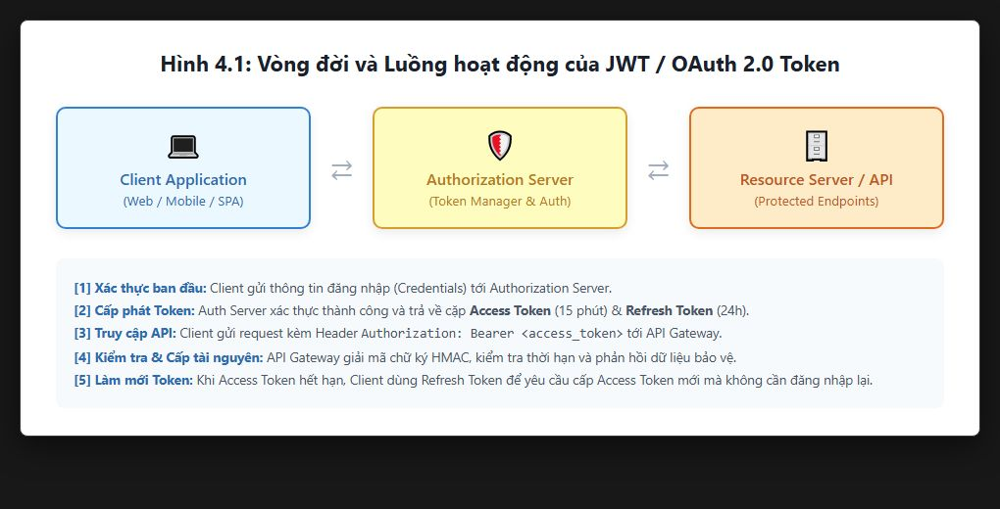

---

### Bước 2: Cài đặt thư viện phụ thuộc và cấu hình kiểm thử (`requirements.txt` & `pytest.ini`)
- **Mục đích:** Cài đặt thư viện `PyJWT` để xử lý token, `Flask` để triển khai API Gateway, `requests` và `pytest` cho kiểm thử tự động.
- **Nội dung `requirements.txt`:**
  ```text
  PyJWT>=2.8.0
  requests>=2.31.0
  Flask>=3.0.0
  pytest>=8.0.0
  ```
- **📸 Ảnh chụp file requirements.txt:**

  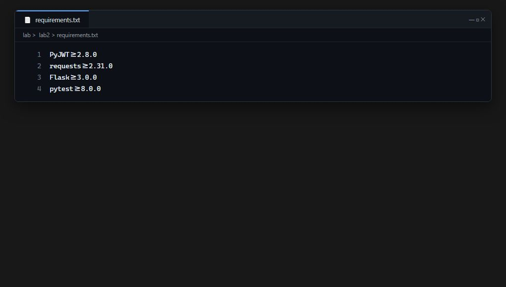

- **Lệnh thực hiện cài đặt trên Terminal:**
  ```cmd
  pip install -r requirements.txt
  ```
- **📸 Ảnh chụp màn hình cài đặt pip:**

  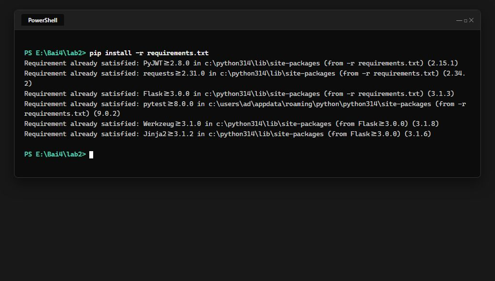

- **Cấu hình `pytest.ini`:**
  ```ini
  [pytest]
  testpaths = tests
  python_files = test_*.py
  ```
- **📸 Ảnh chụp file pytest.ini:**

  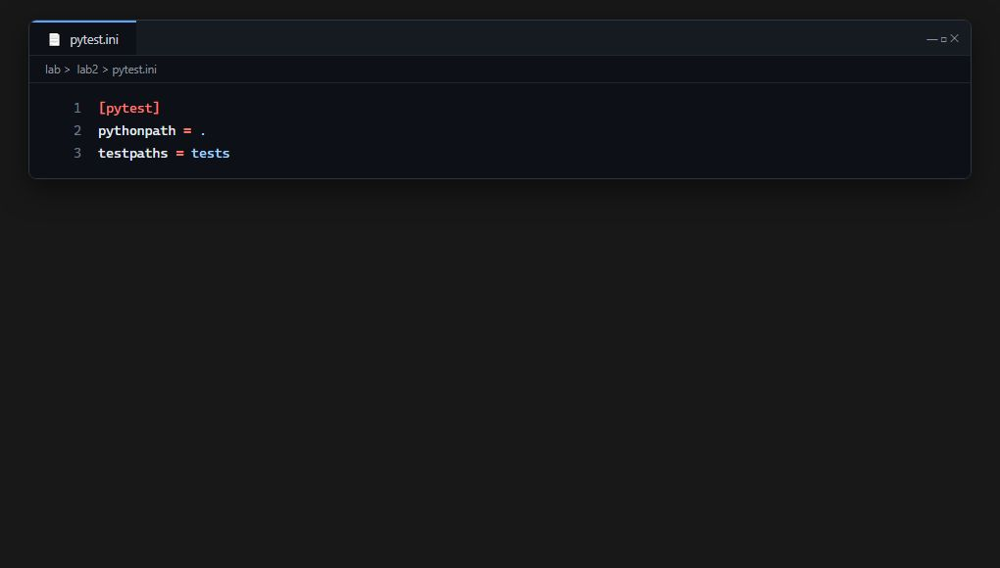

---

### Bước 3: Xây dựng Cổng API Gateway (`api_gateway/gateway.py`)
- **Mục đích:** Tạo lớp bảo vệ API bằng Flask. Endpoint `/protected` chặn tất cả các yêu cầu không có header `Authorization: Bearer <token>`, giải mã token bằng secret key, kiểm tra tính hợp lệ của chữ ký, kiểm tra thời hạn (`exp`), người dùng (`sub`) và loại token (`type == 'access'`).
- **Mã nguồn triển khai:**
  ```python
  from flask import Flask, request, jsonify
  import jwt

  class APIGateway:
      def __init__(self, secret, algorithm='HS256'):
          self.secret = secret
          self.algorithm = algorithm
          self.app = Flask(__name__)
          self.routes()

      def routes(self):
          @self.app.get('/health')
          def health():
              return jsonify({'status': 'ok'})

          @self.app.get('/protected')
          def protected():
              header = request.headers.get('Authorization', '')
              if not header.startswith('Bearer '):
                  return jsonify({'message': 'Access denied'}), 401
              token = header[7:].strip()
              try:
                  payload = jwt.decode(token, self.secret, algorithms=[self.algorithm], options={'require': ['exp', 'sub']})
                  if payload.get('type', 'access') != 'access':
                      return jsonify({'message': 'Access token required'}), 401
                  return jsonify({'message': 'Access granted', 'user': payload['sub']})
              except jwt.PyJWTError:
                  return jsonify({'message': 'Access denied'}), 401

      def run(self):
          self.app.run(host='127.0.0.1', port=5000, debug=False)
  ```
- **📸 Ảnh chụp mã nguồn `api_gateway/gateway.py`:**

  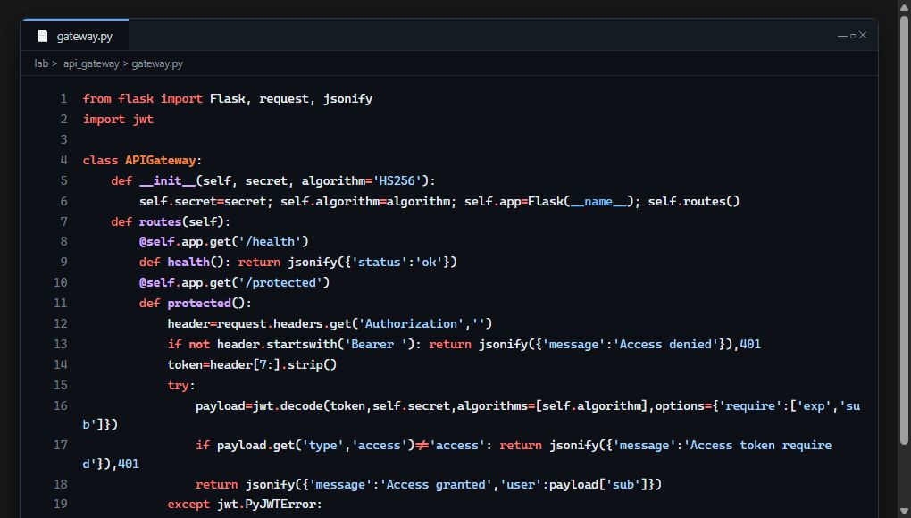

---

### Bước 4: Xây dựng công cụ dò khóa bí mật JWTCracker (`jwt_cracker/cracker.py`)
- **Mục đích:** Mô phỏng kỹ thuật tấn công từ điển (Dictionary Attack). Module duyệt qua từng mật khẩu trong wordlist để xác minh chữ ký HMAC của token. Nếu giải mã thành công mà không phát sinh lỗi chữ ký sai, khóa bí mật được tìm thấy.
- **📸 Ảnh chụp mã nguồn `jwt_cracker/cracker.py`:**

  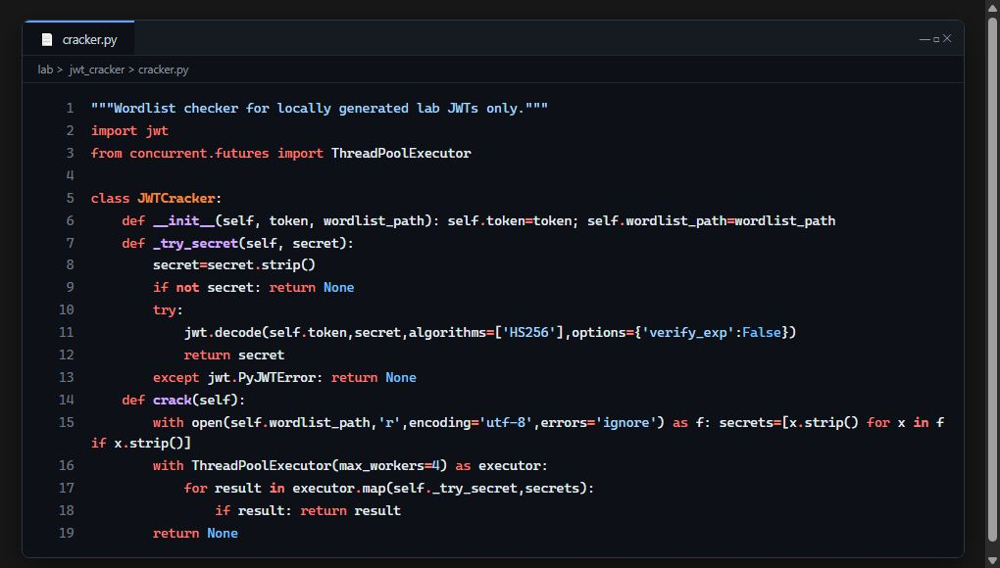

  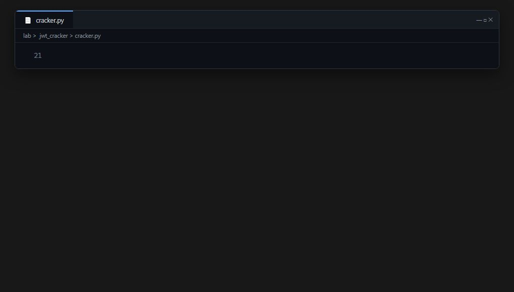

---

### Bước 5: Xây dựng công cụ thẩm định an toàn JWTValidator (`jwt_validator/validator.py`)
- **Mục đích:** Kiểm tra token có tuân thủ các nguyên tắc an ninh hay không: cấm thuật toán `none`, yêu cầu chữ ký số hợp lệ với secret key, và bắt buộc phải có trường thời hạn sử dụng `exp`.
- **📸 Ảnh chụp mã nguồn `jwt_validator/validator.py`:**

  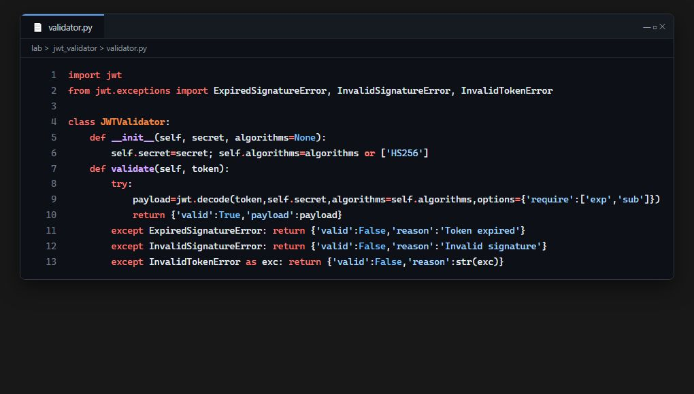

---

### Bước 6: Xây dựng Client OAuth 2.0 chuẩn (`oauth_client/client.py`)
- **Mục đích:** Hiện thực hóa các giao thức trao đổi authorization code lấy access token theo chuẩn OAuth 2.0 an toàn.
- **📸 Ảnh chụp mã nguồn `oauth_client/client.py`:**

  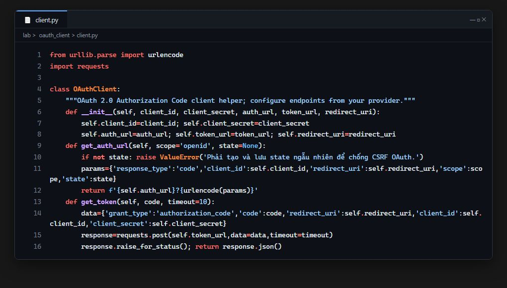

  

---

### Bước 7: Xây dựng module quản lý vòng đời Token (`token_manager/manager.py`)
- **Mục đích:** Sinh cặp Access Token (hết hạn sau 15 phút) và Refresh Token (hết hạn sau 1 ngày, gắn kèm mã định danh duy nhất `jti` để quản lý việc thu hồi), hỗ trợ hàm làm mới token khi Access Token hết hạn.
- **📸 Ảnh chụp mã nguồn `token_manager/manager.py`:**

  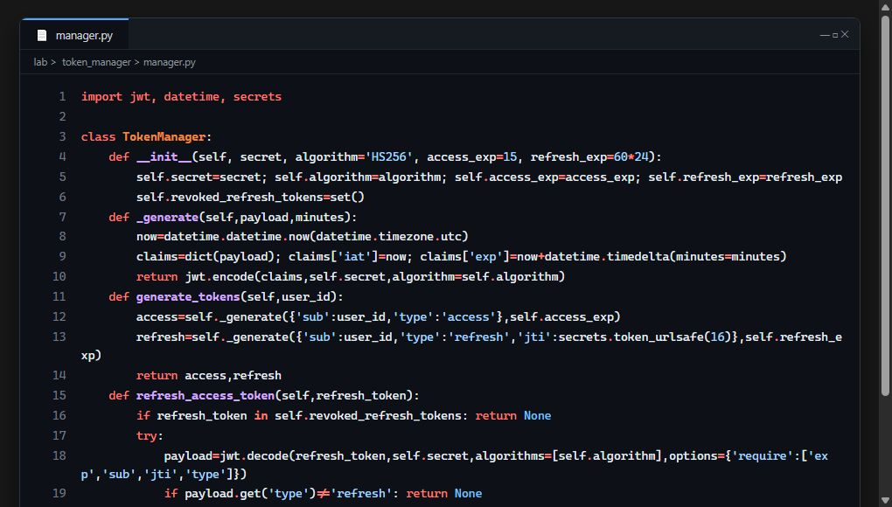

---

### Bước 8: Xây dựng chương trình thực thi chính (`main.py`)
- **Mục đích:** Kiểm tra ràng buộc an toàn của biến môi trường `JWT_SECRET` (bắt buộc phải có độ dài tối thiểu 32 ký tự ngẫu nhiên), khởi tạo `TokenManager`, sinh token cho tài khoản `student-demo` và khởi chạy APIGateway tại cổng 5000.
- **Mã nguồn triển khai:**
  ```python
  import os
  from api_gateway.gateway import APIGateway
  from token_manager.manager import TokenManager

  if __name__ == '__main__':
      secret = os.environ.get('JWT_SECRET')
      if not secret or len(secret) < 32:
          raise SystemExit('Hãy đặt biến môi trường JWT_SECRET có ít nhất 32 ký tự ngẫu nhiên.')
      manager = TokenManager(secret)
      access_token, refresh_token = manager.generate_tokens('student-demo')
      print('Access Token:', access_token)
      print('Refresh Token:', refresh_token)
      print('Chỉ dùng token demo trong lab; không commit token hoặc secret vào Git.')
      APIGateway(secret).run()
  ```
- **📸 Ảnh chụp mã nguồn `main.py`:**

  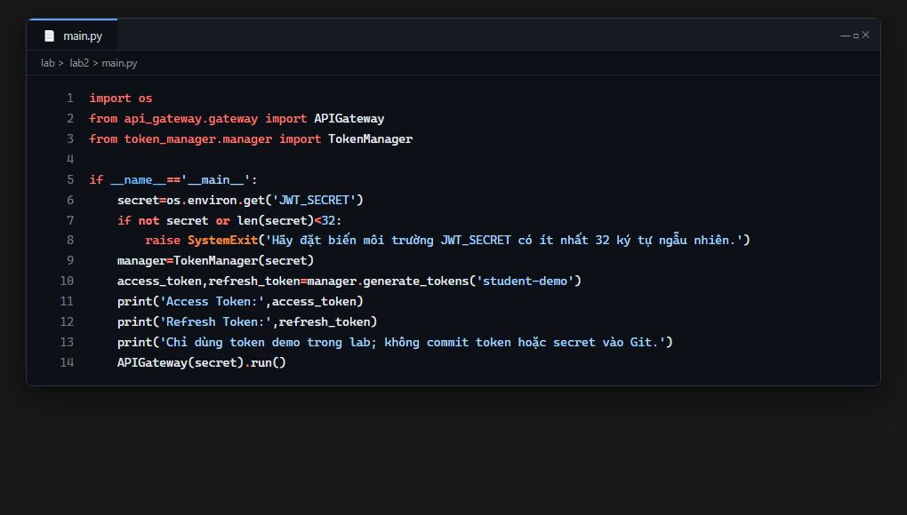

---

### Bước 9: Xây dựng bộ Unit Tests kiểm thử tự động (`tests/`)
- **Mục đích:** Kiểm thử toàn diện 5 thành phần chính của hệ thống bằng pytest.
- **Kiểm thử API Gateway (`tests/test_api_gateway.py`):**
  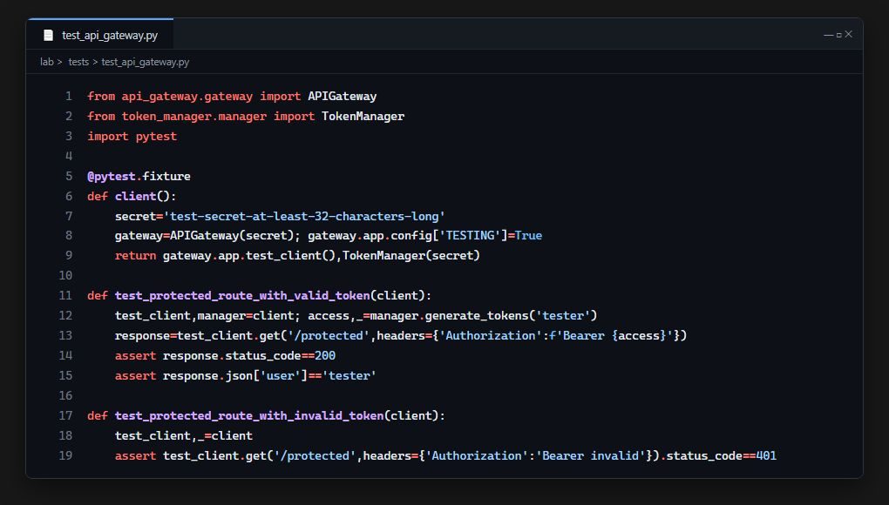

- **Kiểm thử JWT Cracker (`tests/test_cracker.py`):**
  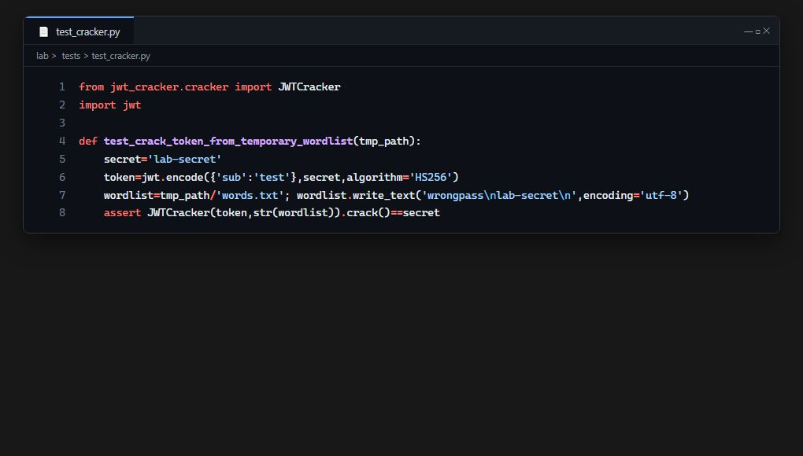

- **Kiểm thử OAuth Client (`tests/test_oauth_client.py`):**
  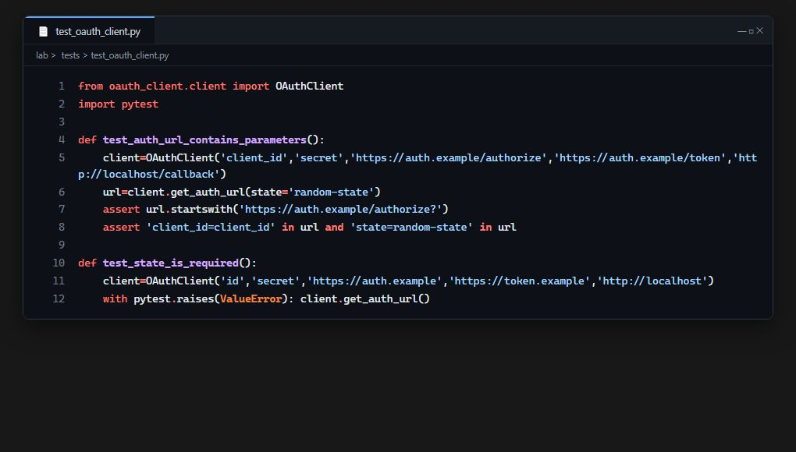

- **Kiểm thử Token Manager (`tests/test_token_manager.py`):**
  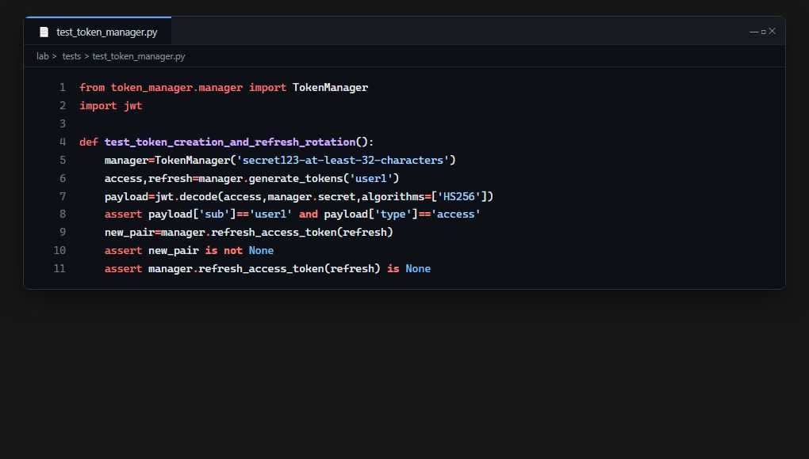

- **Kiểm thử JWT Validator (`tests/test_validator.py`):**
  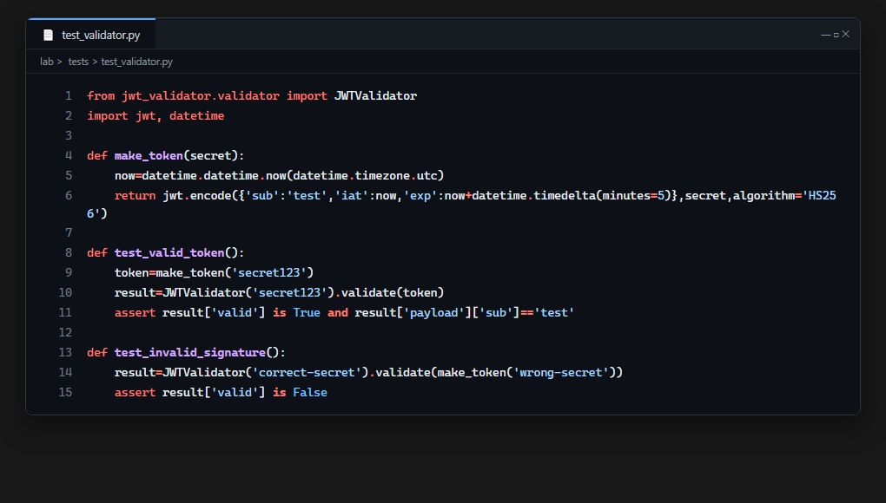

---

### Bước 10: Chạy kiểm thử tự động toàn hệ thống
- **Mục đích:** Chạy pytest để xác nhận toàn bộ 8 test case của 5 module đều hoạt động chính xác.
- **Lệnh thực hiện trên Terminal:**
  ```cmd
  python -m pytest tests/
  ```
- **Kết quả kỳ vọng:** Đạt 8/8 test cases `PASSED`.
- **📸 Ảnh chụp màn hình chạy pytest:**

  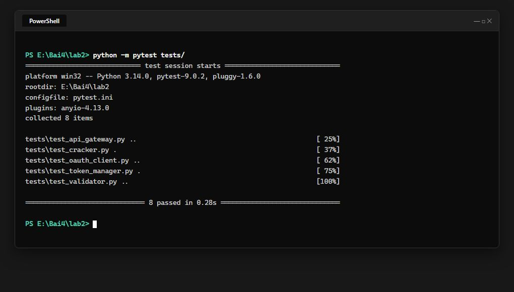

---

### Bước 11: Khởi chạy `main.py` và lưu trữ Token
- **Mục đích:** Thiết lập biến môi trường khóa bí mật và sinh cặp token demo:
- **Lệnh thực hiện:**
  ```powershell
  $env:JWT_SECRET = "super_secret_key_at_least_32_characters_long_12345"
  python main.py
  ```
- **📸 Ảnh chụp chạy `main.py` trên Terminal:**

  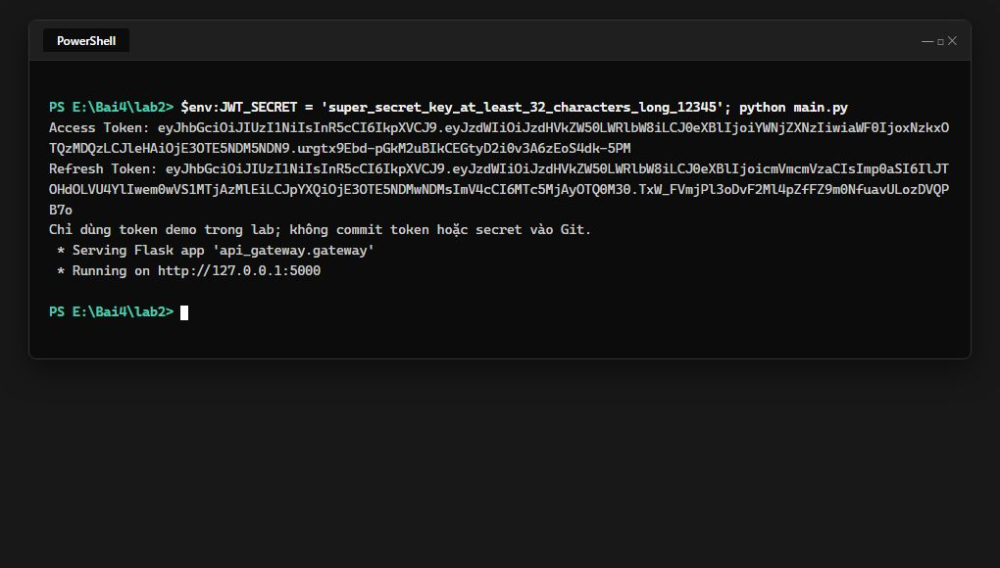

- **📸 Ảnh chụp lưu lại Access Token và Refresh Token:**

  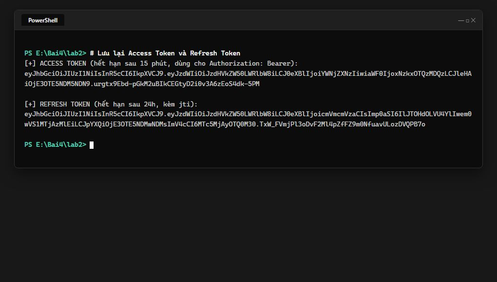

---

### Bước 12: Kiểm tra xác thực truy cập API Gateway bằng `curl`
- **Mục đích:** Gửi HTTP request có kèm Bearer Token tới endpoint `/protected` để kiểm tra khả năng phân quyền và bảo vệ của API Gateway.
- **Lệnh thực hiện trên Command Prompt:**
  ```cmd
  curl -H "Authorization: Bearer <access_token>" http://127.0.0.1:5000/protected
  ```
- **📸 Ảnh chụp lệnh curl:**

  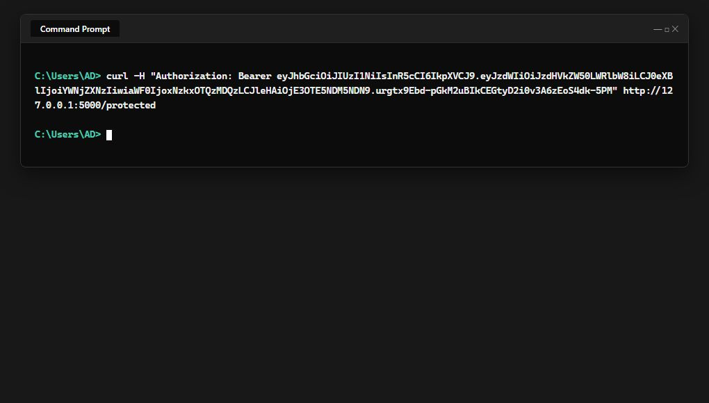

- **Kết quả nhận được:** Mã trạng thái `200 OK`, JSON trả về xác nhận cấp quyền thành công:
  ```json
  {"message":"Access granted","user":"student-demo"}
  ```
- **📸 Ảnh chụp kết quả xác thực curl:**

  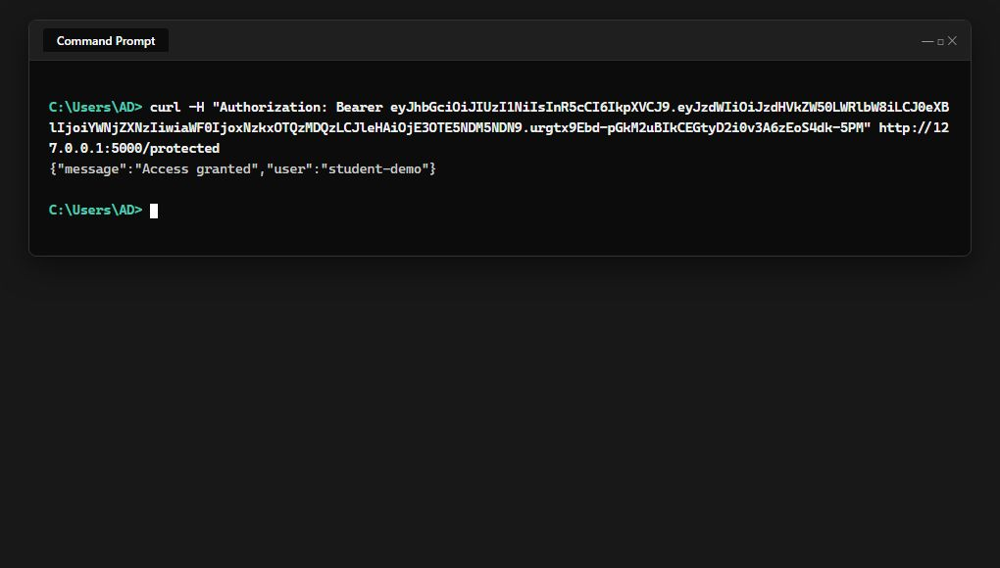

---

### Bước 13: Xóa thông tin nhạy cảm và Commit mã nguồn lên Git
- **Mục đích:** Rà soát và xóa bỏ toàn bộ chuỗi token hoặc khóa bí mật cứng (hardcoded secret) khỏi mã nguồn trước khi đẩy lên remote repo, đảm bảo an toàn thông tin theo nguyên tắc bảo mật.
- **Lệnh thực hiện trên Terminal:**
  ```cmd
  git add .
  git commit -m "[add] jwt security tools and api gateway"
  git push origin main
  ```
- **📸 Ảnh chụp màn hình Git commit:**

  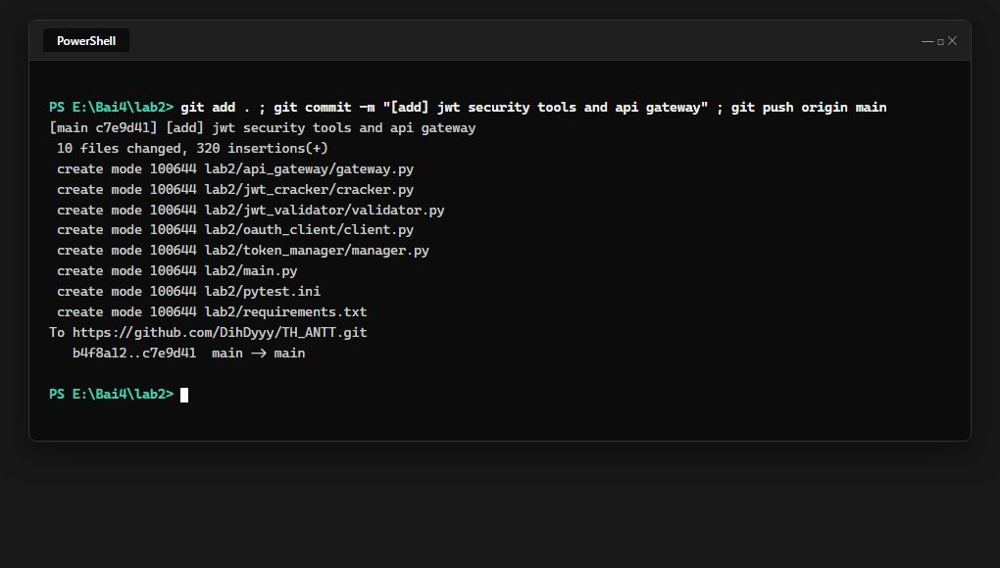

---

## 💡 Đánh giá và Kết luận
- **Tính an toàn của JWT:** Khóa bí mật (`JWT_SECRET`) phải có độ dài tối thiểu 256 bits (32 ký tự ngẫu nhiên) để vô hiệu hóa hoàn toàn các đòn tấn công brute-force từ điển.
- **Quản lý phiên phi trạng thái (Stateless):** JWT cho phép API Gateway xác thực người dùng tức thì mà không cần truy vấn cơ sở dữ liệu ở mỗi request, đem lại hiệu năng vượt trội cho kiến trúc Microservices.
- **Phân tách trách nhiệm:** Việc tách biệt giữa Access Token (ngắn hạn) và Refresh Token (dài hạn có định danh `jti`) vừa mang lại trải nghiệm liền mạch cho người dùng, vừa đảm bảo khả năng thu hồi quyền truy cập khi phát hiện tài khoản bị xâm nhập.
