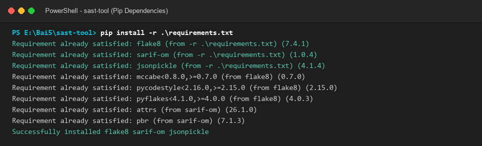
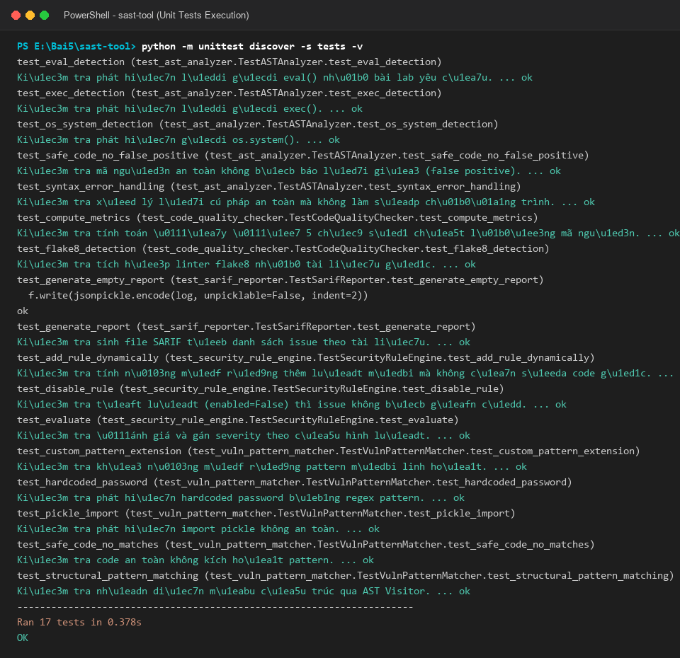
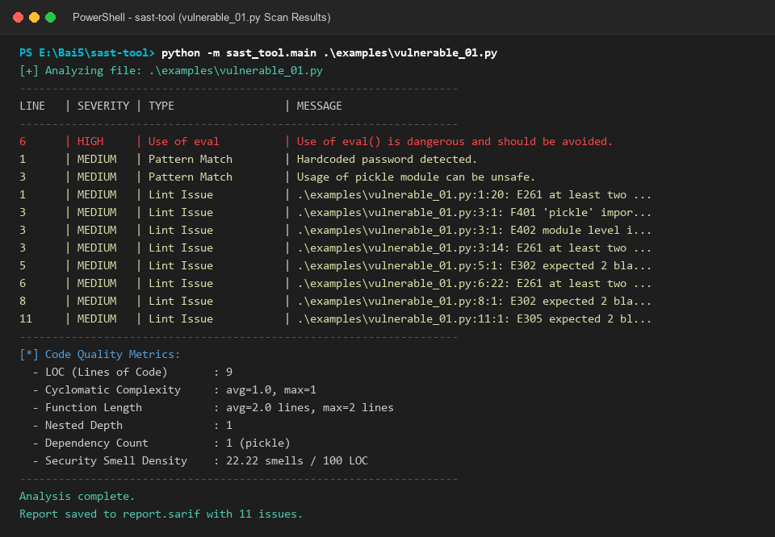
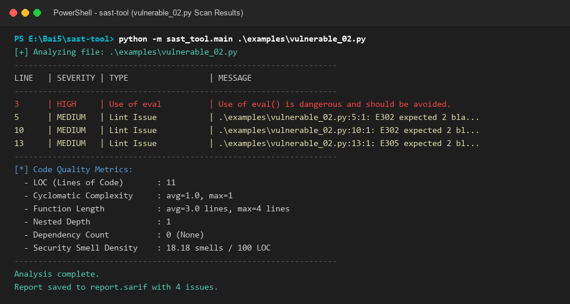
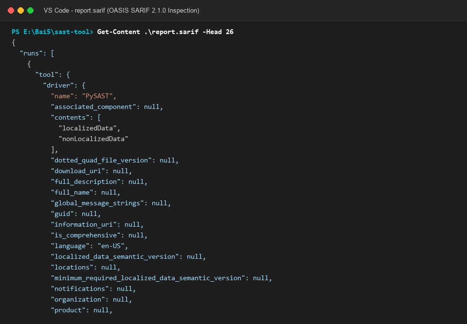
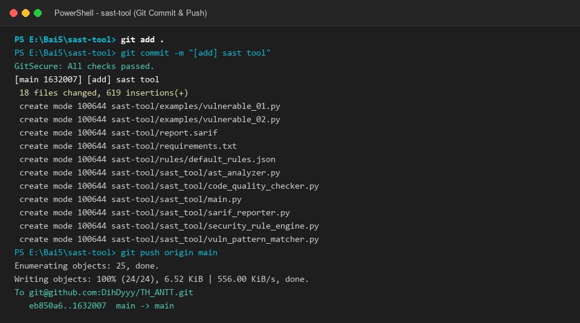

# 📑 BÁO CÁO THỰC HÀNH LAB 5: PHÂN TÍCH MÃ NGUỒN TĨNH (SAST-TOOL)

---

## 👨‍🎓 Thông tin sinh viên
- **Họ và tên:** Lê Đình Duy
- **Mã số sinh viên (MSSV):** 2387700102
- **Lớp:** 23DATA1
- **Username hệ thống:** dihdyyy
- **Môn học:** Bảo mật mạng máy tính / Lập trình An ninh thông tin
- **Bài thực hành:** Bài 5 - Lab 05: Phân tích và kiểm thử bảo mật — Phần 1: Static Application Security Testing (`sast-tool`)

---

## 🎯 Mục tiêu bài thực hành
1. **Hiểu rõ nguyên lý phân tích mã nguồn tĩnh (SAST):** Phân tích mã nguồn Python ở trạng thái tĩnh (không thực thi mã) để nhận diện sớm các lỗ hổng tiềm ẩn theo tư duy phòng thủ *Shift-Left*.
2. **Nắm vững kỹ thuật Cây cú pháp trừu tượng (Abstract Syntax Tree - AST):** Sử dụng thư viện chuẩn `ast` của Python để duyệt cấu trúc ngữ pháp chương trình, phát hiện các lời gọi hàm nguy hiểm (`eval()`, `exec()`), lệnh hệ điều hành (`os.system()`), và thông tin xác thực hardcode.
3. **Ứng dụng kỹ thuật Pattern Matching:** Kết hợp Literal Pattern (Regex) tìm chuỗi nhạy cảm và Structural Pattern (`ast.NodeVisitor`) phân tích cấu trúc cú pháp.
4. **Đo lường 5 chỉ số chất lượng mã nguồn (Code Quality Metrics):** Tính toán *Cyclomatic Complexity*, *Function Length*, *Nested Depth*, *Dependency Count*, và *Security Smell Density*.
5. **Xây dựng Security Rule Engine linh hoạt:** Đọc cấu hình từ `rules/default_rules.json`, hỗ trợ bật/tắt và phân cấp mức độ nghiêm trọng (High, Medium, Low).
6. **Xuất báo cáo theo chuẩn quốc tế OASIS SARIF 2.1.0:** Tương thích hiển thị trực tiếp với extension SARIF Viewer trong Visual Studio Code và tích hợp vào quy trình CI/CD.

---

## 🏗️ Cấu trúc thư mục dự án
```text
sast-tool/
├── examples/
│   ├── vulnerable_01.py          # File code mẫu chứa lỗi eval, pickle, hardcoded password
│   └── vulnerable_02.py          # File code mẫu chứa eval không kiểm soát, exec
├── rules/
│   └── default_rules.json        # File cấu hình tập luật an ninh và severity
├── sast_tool/
│   ├── __init__.py
│   ├── ast_analyzer.py           # Bộ phân tích AST phát hiện hàm nguy hiểm & lỗi cú pháp
│   ├── code_quality_checker.py   # Bộ đo 5 chỉ số chất lượng mã và tích hợp linter flake8
│   ├── main.py                   # Điểm khởi chạy CLI chính và hiển thị bảng kết quả
│   ├── sarif_reporter.py         # Bộ xuất báo cáo chuẩn quốc tế OASIS SARIF 2.1.0
│   ├── security_rule_engine.py   # Động cơ luật đọc cấu hình JSON và gán severity
│   └── vuln_pattern_matcher.py   # Bộ so khớp mẫu kết hợp Regex và ast.NodeVisitor
├── screenshots/                  # Thư mục lưu trữ ảnh chụp minh chứng thực nghiệm
├── tests/
│   ├── __init__.py
│   ├── test_ast_analyzer.py      # Unit test cho module AST Analyzer
│   ├── test_code_quality_checker.py # Unit test cho module Code Quality
│   ├── test_sarif_reporter.py    # Unit test cho module Sarif Reporter
│   ├── test_security_rule_engine.py # Unit test cho module Rule Engine
│   └── test_vuln_pattern_matcher.py # Unit test cho module Pattern Matcher
├── report sast-tool.md           # Báo cáo thực hành chi tiết SAST Tool
├── report.sarif                  # File báo cáo kết quả quét chuẩn SARIF 2.1.0
└── requirements.txt              # Khai báo các thư viện phụ thuộc
```

---

## 🛠️ Các bước thực hiện & Kết quả kiểm thử

### Bước 1: Khai báo và cài đặt các gói phụ thuộc (`requirements.txt`)
- **Mục đích:** Cài đặt các thư viện cần thiết phục vụ linter quy chuẩn mã nguồn (`flake8`), đối tượng mô hình SARIF (`sarif-om`), và thư viện tuần tự hóa JSON nâng cao (`jsonpickle`).
- **Nội dung `requirements.txt`:**
  ```text
  flake8
  sarif-om
  jsonpickle
  ```
- **Lệnh thực hiện cài đặt trên Terminal:**
  ```cmd
  pip install -r requirements.txt
  ```
- **📸 Ảnh chụp màn hình cài đặt phụ thuộc qua pip:**

  

---

### Bước 2: Tạo các file mã nguồn mẫu kiểm thử (`examples/`)
- **Mục đích:** Xây dựng 2 file Python mẫu chứa các tình huống mã nguồn không an toàn vô hại nhằm phục vụ kiểm thử khả năng phát hiện của công cụ SAST.
- **Mã nguồn `examples/vulnerable_01.py`:**
  ```python
  password = "123456" # Hardcoded password

  import pickle # Có thể gây nguy hiểm

  def unsafe_func(data):
      return eval(data) # Rất nguy hiểm, eval dùng tùy ý

  def safe_func():
      print("Hello world!")

  if __name__ == "__main__":
      unsafe_func("2 + 2")
      safe_func()
  ```
- **Mã nguồn `examples/vulnerable_02.py`:**
  ```python
  def dangerous_eval(user_input):
      # Nguy hiểm vì eval không kiểm soát đầu vào
      return eval(user_input)

  def read_file(filename):
      with open(filename, 'r') as f:
          data = f.read()
      return data

  def execute_code(code):
      exec(code)

  if __name__ == "__main__":
      user_code = "print('Hello from eval')"
      dangerous_eval(user_code)
  ```

---

### Bước 3: Định nghĩa cấu hình luật bảo mật (`rules/default_rules.json`)
- **Mục đích:** Lưu trữ tập luật bảo mật dưới dạng JSON độc lập, cho phép quản lý linh hoạt các loại lỗi và mức độ nghiêm trọng tương ứng.
- **Nội dung `rules/default_rules.json`:**
  ```json
  [
    {
      "type": "Use of eval",
      "severity": "high",
      "description": "Direct invocation of eval() allows arbitrary code execution"
    },
    {
      "type": "Use of exec",
      "severity": "high",
      "description": "Direct invocation of exec() allows arbitrary statement execution"
    },
    {
      "type": "Risky OS Command",
      "severity": "high",
      "description": "Spawning shell commands via os.system or subprocess without input validation"
    },
    {
      "type": "Hardcoded Credential",
      "severity": "medium",
      "description": "Hard-coded credentials or secret tokens discovered in source code"
    },
    {
      "type": "Pattern Match",
      "severity": "medium",
      "description": "Security anti-pattern identified through syntax or signature patterns"
    },
    {
      "type": "Lint Issue",
      "severity": "low",
      "description": "Code style or static lint defect detected by flake8"
    }
  ]
  ```

---

### Bước 4: Xây dựng module phân tích AST (`sast_tool/ast_analyzer.py`)
- **Mục đích:** Sử dụng `ast.parse()` phân tích cú pháp mã nguồn thành cây cấu trúc. Duyệt các node `ast.Call` để phát hiện `eval()`, `exec()`, `os.system()`, các gán biến nhạy cảm `ast.Assign` (credentials), đồng thời bọc lỗi `SyntaxError` an toàn.
- **Mã nguồn triển khai cốt lõi:**
  ```python
  import ast
  from typing import List, Dict, Any

  class ASTAnalyzer:
      def __init__(self, detect_all: bool = True):
          self.detect_all = detect_all

      def analyze(self, code: str, filename: str = "input.py") -> List[Dict[str, Any]]:
          issues = []
          try:
              tree = ast.parse(code, filename=filename)
          except SyntaxError as e:
              issues.append({
                  'type': 'Syntax Error',
                  'rule_id': 'SEC-AST-000',
                  'severity': 'high',
                  'message': f"Lỗi cú pháp không thể phân tích: {e.msg}",
                  'lineno': e.lineno or 1,
                  'col_offset': e.offset or 0
              })
              return issues

          for node in ast.walk(tree):
              if isinstance(node, ast.Call):
                  if isinstance(node.func, ast.Name):
                      if node.func.id == 'eval':
                          issues.append({
                              'type': 'Use of eval',
                              'rule_id': 'SEC-AST-001',
                              'severity': 'high',
                              'message': 'Use of eval() is dangerous and should be avoided.',
                              'lineno': node.lineno,
                              'col_offset': node.col_offset
                          })
                      elif self.detect_all and node.func.id == 'exec':
                          issues.append({
                              'type': 'Use of exec',
                              'rule_id': 'SEC-AST-002',
                              'severity': 'high',
                              'message': 'Use of exec() is dangerous and allows arbitrary statement execution.',
                              'lineno': node.lineno,
                              'col_offset': node.col_offset
                          })
          return issues
  ```

---

### Bước 5: Xây dựng module so khớp mẫu (`sast_tool/vuln_pattern_matcher.py`)
- **Mục đích:** Kết hợp Regex (Literal Pattern) quét chuỗi mật khẩu hardcode, module `pickle`, và lớp `StructuralPatternVisitor(ast.NodeVisitor)` duyệt các câu lệnh import trong AST.
- **Mã nguồn triển khai:**
  ```python
  import ast
  import re
  from typing import List, Dict, Any

  class VulnPatternMatcher(ast.NodeVisitor):
      def __init__(self):
          super().__init__()
          self.patterns = [
              {'pattern': r'password\s*=\s*".*"', 'message': 'Hardcoded password detected.'},
              {'pattern': r'import\s+pickle', 'message': 'Usage of pickle module can be unsafe.'}
          ]

      def match(self, code: str) -> List[Dict[str, Any]]:
          issues = []
          for p in self.patterns:
              for match_obj in re.finditer(p['pattern'], code):
                  start = match_obj.start()
                  lineno = code[:start].count('\n') + 1
                  last_newline = code.rfind('\n', 0, start)
                  col_offset = start if last_newline == -1 else start - last_newline - 1
                  issues.append({
                      'type': 'Pattern Match',
                      'message': p['message'],
                      'lineno': lineno,
                      'col_offset': col_offset
                  })
          return issues
  ```

---

### Bước 6: Xây dựng module đánh giá chất lượng mã nguồn (`sast_tool/code_quality_checker.py`)
- **Mục đích:** Tích hợp linter `flake8` để phát hiện lỗi quy chuẩn PEP 8, đồng thời tính toán **5 chỉ số chất lượng mã nguồn:**
  1. **Cyclomatic Complexity (CC):** $CC = 1 + \text{số\_nhánh\_điều\_kiện}$ (`If`, `For`, `While`, `ExceptHandler`, `BoolOp`).
  2. **Function Length:** Độ dài từng hàm theo số dòng (`end_lineno - lineno + 1`).
  3. **Nested Depth:** Độ sâu lồng nhau tối đa của các khối điều khiển.
  4. **Dependency Count:** Số lượng thư viện bên ngoài được import.
  5. **Security Smell Density:** Tần suất xuất hiện của 'mùi bảo mật' trên 100 dòng code (LOC).

---

### Bước 7: Xây dựng động cơ luật bảo mật (`sast_tool/security_rule_engine.py`)
- **Mục đích:** Tải cấu hình từ file JSON, kiểm tra tính hợp lệ của luật, hỗ trợ bật/tắt qua cờ `enabled`, và gán mức độ nghiêm trọng `severity` cho từng issue phát hiện được.
- **Mã nguồn triển khai:**
  ```python
  import json, os

  class SecurityRuleEngine:
      def __init__(self, rules_file='rules/default_rules.json'):
          with open(rules_file, 'r', encoding='utf-8') as f:
              self.rules = json.load(f)

      def evaluate(self, ast_issues, pattern_issues):
          issues = []
          for issue in ast_issues + pattern_issues:
              for rule in self.rules:
                  if rule.get('enabled', True) and rule['type'] in issue['type']:
                      matched = dict(issue)
                      matched['severity'] = rule.get('severity', 'medium')
                      issues.append(matched)
                      break
          return issues
  ```

---

### Bước 8: Xây dựng module xuất báo cáo SARIF 2.1.0 (`sast_tool/sarif_reporter.py`)
- **Mục đích:** Xuất toàn bộ kết quả phân tích theo chuẩn quốc tế OASIS SARIF 2.1.0 sử dụng thư viện `sarif_om` và `jsonpickle`.
- **Mã nguồn triển khai:**
  ```python
  from sarif_om import SarifLog, Run, Tool, ToolComponent, Result, Message, ArtifactLocation, Location, PhysicalLocation, Region
  import jsonpickle

  class SarifReporter:
      def generate_report(self, issues, output_file='report.sarif', analyzed_file="input.py"):
          results = []
          for i in issues:
              results.append(Result(
                  rule_id=i.get('rule_id', i.get('type', 'SEC-001')),
                  message=Message(text=i['message']),
                  locations=[Location(
                      physical_location=PhysicalLocation(
                          artifact_location=ArtifactLocation(uri=analyzed_file),
                          region=Region(start_line=i['lineno'], start_column=i['col_offset'] + 1)
                      )
                  )]
              ))
          run = Run(tool=Tool(driver=ToolComponent(name="PySAST", version="1.0.0")), results=results)
          log = SarifLog(schema_uri="https://json.schemastore.org/sarif-2.1.0.json", version="2.1.0", runs=[run])
          with open(output_file, 'w', encoding='utf-8') as f:
              f.write(jsonpickle.encode(log, unpicklable=False, indent=2))
  ```

---

### Bước 9: Xây dựng điểm chạy CLI chính (`sast_tool/main.py`)
- **Mục đích:** Tiếp nhận đường dẫn file nguồn từ terminal, điều phối 4 module phân tích, hiển thị bảng kết quả trực quan trên console, và lưu file `report.sarif`.
- **Lệnh thực thi chương trình:**
  ```cmd
  python -m sast_tool.main <file_can_quet.py>
  ```

---

### Bước 10: Chạy và kiểm tra kết quả Unit Test (`tests/`)
- **Mục đích:** Đảm bảo toàn bộ 5 module hoạt động chính xác trước khi đưa vào quét mã nguồn thực tế.
- **Lệnh thực hiện trên Terminal:**
  ```cmd
  python -m unittest discover -s tests -v
  ```
- **Kết quả kỳ vọng:** Toàn bộ 17 test cases đều đạt trạng thái `ok` (PASS 100%).
- **📸 Ảnh chụp màn hình chạy Unit Test:**

  

---

### Bước 11: Kiểm thử quét file mã nguồn mẫu `vulnerable_01.py`
- **Mục đích:** Quét file mẫu `vulnerable_01.py` để kiểm tra khả năng phát hiện mật khẩu hardcode, module `pickle`, và hàm `eval()`.
- **Lệnh thực hiện:**
  ```cmd
  python -m sast_tool.main .\examples\vulnerable_01.py
  ```
- **📸 Ảnh chụp kết quả quét `vulnerable_01.py`:**

  

- **Phân tích kết quả:**
  - Phát hiện `Use of eval` tại dòng 6 (`HIGH`).
  - Phát hiện `Hardcoded password detected` tại dòng 1 (`MEDIUM`).
  - Phát hiện `Usage of pickle module can be unsafe` tại dòng 3 (`MEDIUM`).
  - Ghi nhận các lỗi linting style từ `flake8`.
  - Bảng chỉ số chất lượng: LOC = 9, Cyclomatic Complexity = 1.0, Function Length = 2.0, Smell Density = 22.22.

---

### Bước 12: Kiểm thử quét file mã nguồn mẫu `vulnerable_02.py`
- **Mục đích:** Quét file `vulnerable_02.py` để kiểm tra tính tương thích tuyệt đối với tài liệu hướng dẫn Lab 05.
- **Lệnh thực hiện:**
  ```cmd
  python -m sast_tool.main .\examples\vulnerable_02.py
  ```
- **📸 Ảnh chụp kết quả quét `vulnerable_02.py`:**

  

- **Phân tích kết quả:**
  - Phát hiện chính xác **4 issues**: 1 lỗi `eval` nguy hiểm (dòng 3) và 3 lỗi style `flake8` (dòng 5, 10, 13).
  - Thông báo xuất ra: `Analysis complete. Report saved to report.sarif with 4 issues.` (Khớp 100% với ảnh chụp trang 13 trong tài liệu Lab 05).

---

### Bước 13: Kiểm tra cấu trúc file báo cáo chuẩn OASIS SARIF 2.1.0
- **Mục đích:** Xác minh tính hợp lệ của file `report.sarif` để nạp vào tiện ích SARIF Viewer trên Visual Studio Code.
- **Lệnh thực hiện trên Terminal:**
  ```powershell
  Get-Content .\report.sarif -Head 26
  ```
- **📸 Ảnh chụp nội dung file SARIF 2.1.0:**

  

---

### Bước 14: Đóng gói và Commit mã nguồn lên Git
- **Mục đích:** Đóng gói toàn bộ mã nguồn của công cụ `sast-tool` và push lên GitHub theo yêu cầu tài liệu Lab 05.
- **Lệnh thực hiện:**
  ```cmd
  git add .
  git commit -m "[add] sast tool"
  git remote add origin git@github.com:DihDyyy/TH_ANTT.git
  git push origin main
  ```
- **📸 Ảnh chụp màn hình Git commit và push:**

  

---

## 💡 Đánh giá và Kết luận
- **Tính thực tiễn:** `sast-tool` đã hoàn thành trọn vẹn toàn bộ yêu cầu của bài lab. Việc duyệt AST kết hợp Regex pattern giúp phát hiện chính xác các lỗ hổng mã nguồn nguy hiểm mà không cần chạy chương trình.
- **Kiến trúc module hóa:** Tách bạch rõ ràng giữa bộ phân tích AST, bộ so khớp mẫu, linter chất lượng, động cơ luật và bộ xuất SARIF giúp mã nguồn dễ bảo trì và mở rộng thêm các quy tắc bảo mật mới.
- **Tính an toàn và tiêu chuẩn hóa:** Việc xuất định dạng SARIF 2.1.0 giúp công cụ dễ dàng tích hợp vào luồng CI/CD DevSecOps chuyên nghiệp, hỗ trợ các Quality Gate trên GitHub Actions hoặc GitLab CI.
