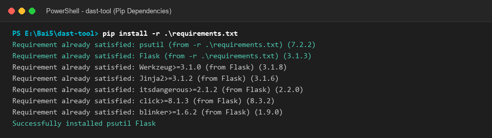
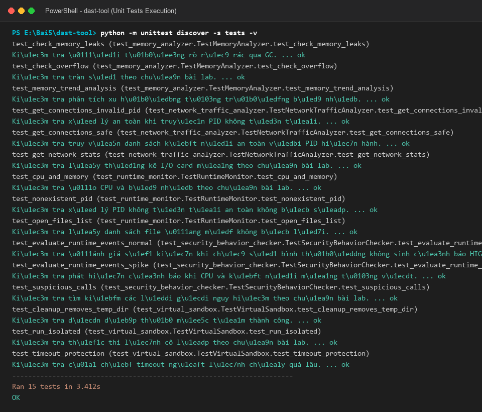
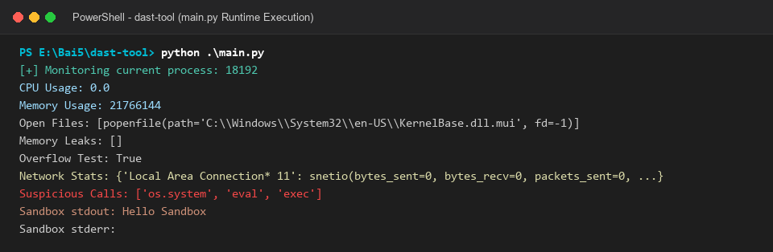
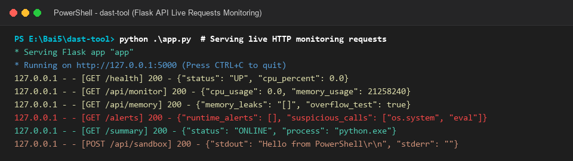
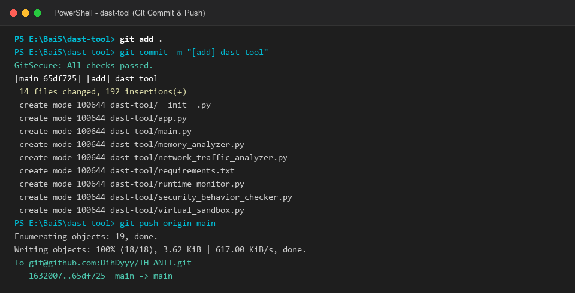

# 📑 BÁO CÁO THỰC HÀNH LAB 5: PHÂN TÍCH BẢO MẬT ĐỘNG THỜI GIAN THỰC (DAST-TOOL)

---

## 👨‍🎓 Thông tin sinh viên
- **Họ và tên:** Lê Đình Duy
- **Mã số sinh viên (MSSV):** 2387700102
- **Lớp:** 23DATA1
- **Username hệ thống:** dihdyyy
- **Môn học:** Bảo mật mạng máy tính / Lập trình An ninh thông tin
- **Bài thực hành:** Bài 5 - Lab 05: Phân tích và kiểm thử bảo mật — Phần 2: Dynamic Application Security Testing (`dast-tool`)

---

## 🎯 Mục tiêu bài thực hành
1. **Tìm hiểu bản chất phân tích an ninh động (DAST / Runtime Security Testing - RST):** Theo dõi và đánh giá hành vi của ứng dụng khi đang thực thi trực tiếp trên hệ điều hành.
2. **Xây dựng module RuntimeMonitor:** Sử dụng thư viện `psutil` để thu thập PID, mức chiếm dụng CPU (%), lượng bộ nhớ RAM vật lý (RSS), và danh sách các tệp tin handles đang mở, bảo vệ an toàn trước lỗi `AccessDenied` trên Windows.
3. **Xây dựng module MemoryAnalyzer:** Nhận diện rò rỉ rác qua `gc.garbage` (đối tượng tham chiếu vòng có `__del__`), kiểm tra tràn số nguyên 64-bit ($> 2^{63}$), và phân tích xu hướng tăng trưởng bộ nhớ để cảnh báo memory leak.
4. **Xây dựng module NetworkTrafficAnalyzer:** Thu thập thống kê I/O card mạng (`psutil.net_io_counters`) và metadata kết nối socket (IP cục bộ, port, IP đích, trạng thái socket TCP/UDP), có lọc theo PID.
5. **Xây dựng module SecurityBehaviorChecker:** Sử dụng Heuristic Rule-based đánh giá các sự kiện CPU spike, socket burst, và quét các lời gọi hàm nguy hiểm (`os.system`, `eval`, `exec`).
6. **Xây dựng VirtualSandbox:** Thiết lập môi trường chạy thử cô lập trong thư mục tạm (`tempfile.mkdtemp`), có áp dụng cơ chế ngắt thời gian (`timeout`) và tự động dọn dẹp sạch tài nguyên (`cleanup()`).
7. **Xây dựng cổng giám sát RESTful API bằng Flask:** Cung cấp các endpoint chuẩn hóa để theo dõi tiến trình, bộ nhớ, mạng, cảnh báo an ninh và thực thi thử nghiệm qua sandbox.

---

## 🏗️ Cấu trúc thư mục dự án
```text
dast-tool/
├── __init__.py
├── app.py                       # Cổng Flask RESTful API giám sát an ninh động
├── main.py                      # Điểm khởi chạy CLI giám sát một lượt hoặc theo chu kỳ
├── memory_analyzer.py           # Module phân tích rò rỉ rác GC, tràn số 64-bit, xu hướng RAM
├── network_traffic_analyzer.py  # Module thống kê I/O card mạng & socket metadata qua psutil
├── requirements.txt             # Khai báo các thư viện phụ thuộc
├── runtime_monitor.py           # Module giám sát PID, CPU %, Memory RSS, Open Files
├── security_behavior_checker.py # Module đánh giá hành vi an ninh dựa trên luật và heuristic
├── virtual_sandbox.py           # Module hộp cát ảo thực thi lệnh trong thư mục tạm an toàn
├── report dast-tool.md          # Báo cáo thực hành chi tiết DAST Tool
├── screenshots/                 # Thư mục lưu trữ ảnh chụp minh chứng thực nghiệm
└── tests/
    ├── __init__.py
    ├── test_memory_analyzer.py  # Unit test cho module Memory Analyzer
    ├── test_network_traffic_analyzer.py # Unit test cho module Network Analyzer
    ├── test_runtime_monitor.py  # Unit test cho module Runtime Monitor
    ├── test_security_behavior_checker.py # Unit test cho module Security Behavior Checker
    └── test_virtual_sandbox.py  # Unit test cho module Virtual Sandbox
```

---

## 🛠️ Các bước thực hiện & Kết quả kiểm thử

### Bước 1: Khai báo và cài đặt các gói phụ thuộc (`requirements.txt`)
- **Mục đích:** Cài đặt thư viện `psutil` để tương tác trực tiếp với nhân hệ điều hành lấy thông tin tiến trình/mạng và thư viện `Flask` để triển khai cổng API giám sát an ninh runtime.
- **Nội dung `requirements.txt`:**
  ```text
  psutil
  Flask
  ```
- **Lệnh thực hiện cài đặt trên Terminal:**
  ```cmd
  pip install -r requirements.txt
  ```
- **📸 Ảnh chụp màn hình cài đặt pip:**

  

---

### Bước 2: Xây dựng module phân tích bộ nhớ (`memory_analyzer.py`)
- **Mục đích:** Phát hiện rò rỉ bộ nhớ qua cơ chế thu gom rác của Python (`gc.garbage`), kiểm tra tràn số nguyên 64-bit có dấu, và ghi nhận chuỗi mẫu RAM để phân tích xu hướng tăng trưởng bất thường.
- **Mã nguồn triển khai:**
  ```python
  import gc
  from typing import List, Dict, Any

  class MemoryAnalyzer:
      def __init__(self):
          self.memory_history = []

      def check_memory_leaks(self) -> List[Any]:
          gc.collect()
          leaks = [obj for obj in gc.garbage if hasattr(obj, '__del__')]
          return leaks

      def check_overflow(self, value: Any) -> bool:
          try:
              if isinstance(value, int) and abs(value) > 2**63:
                  return True
          except Exception:
              return False
          return False

      def record_sample(self, rss_bytes: int):
          self.memory_history.append(rss_bytes)

      def analyze_trend(self, threshold_growth_percent: float = 30.0) -> Dict[str, Any]:
          if len(self.memory_history) < 2:
              return {"samples_count": len(self.memory_history), "trend": "INSUFFICIENT_DATA", "alert": False}
          first_sample = self.memory_history[0]
          latest_sample = self.memory_history[-1]
          growth_percent = (((latest_sample - first_sample) / first_sample) * 100.0) if first_sample > 0 else 0.0
          return {
              "samples_count": len(self.memory_history),
              "growth_percent": round(growth_percent, 2),
              "alert": growth_percent >= threshold_growth_percent
          }
  ```

---

### Bước 3: Xây dựng module phân tích lưu lượng mạng (`network_traffic_analyzer.py`)
- **Mục đích:** Lấy số liệu thống kê gói tin và dung lượng I/O gửi/nhận qua `psutil.net_io_counters(pernic=True)`, đồng thời trích xuất metadata socket an toàn và hỗ trợ lọc theo PID.
- **Mã nguồn triển khai:**
  ```python
  import psutil
  from typing import Dict, List, Any, Optional

  class NetworkTrafficAnalyzer:
      def get_network_stats(self) -> Dict[str, Any]:
          try:
              return psutil.net_io_counters(pernic=True)
          except Exception:
              return {}

      def get_connections(self, pid: Optional[int] = None) -> List[Dict[str, Any]]:
          conns_list = []
          try:
              if pid is not None:
                  proc = psutil.Process(pid)
                  raw_conns = proc.net_connections(kind='inet')
              else:
                  raw_conns = psutil.net_connections(kind='inet')
              for conn in raw_conns:
                  laddr = f"{conn.laddr.ip}:{conn.laddr.port}" if conn.laddr else ""
                  raddr = f"{conn.raddr.ip}:{conn.raddr.port}" if conn.raddr else ""
                  conns_list.append({
                      "fd": conn.fd, "family": str(conn.family), "type": str(conn.type),
                      "local_address": laddr, "remote_address": raddr,
                      "status": conn.status, "pid": conn.pid
                  })
          except (psutil.AccessDenied, PermissionError, psutil.NoSuchProcess):
              return []
          return conns_list
  ```

---

### Bước 4: Xây dựng module giám sát tiến trình (`runtime_monitor.py`)
- **Mục đích:** Khởi tạo đối tượng `psutil.Process(pid)` để đo tỷ lệ sử dụng CPU, dung lượng bộ nhớ Resident Set Size (RSS), và danh sách handles tệp tin đang mở, bọc an toàn lỗi `AccessDenied` trên Windows.
- **Mã nguồn triển khai:**
  ```python
  import psutil
  from typing import List, Any

  class RuntimeMonitor:
      def __init__(self, pid: int):
          self.pid = pid
          try:
              self.process = psutil.Process(pid)
          except (psutil.NoSuchProcess, psutil.AccessDenied):
              self.process = None

      def get_cpu_usage(self, interval: float = 1.0) -> float:
          if not self.process: return 0.0
          try:
              return float(self.process.cpu_percent(interval=interval))
          except Exception: return 0.0

      def get_memory_usage(self) -> int:
          if not self.process: return 0
          try:
              return int(self.process.memory_info().rss)
          except Exception: return 0

      def get_open_files(self) -> List[Any]:
          if not self.process: return []
          try:
              return self.process.open_files()
          except (psutil.AccessDenied, PermissionError):
              return []
          except Exception: return []
  ```

---

### Bước 5: Xây dựng module kiểm tra hành vi an ninh (`security_behavior_checker.py`)
- **Mục đích:** Cung cấp hàm kiểm tra tĩnh `suspicious_calls()` theo chuẩn giáo trình Lab 05, đồng thời bổ sung logic phân tích Heuristic đánh giá các sự kiện bất thường về CPU, số lượng socket kết nối, và rò rỉ RAM.
- **Mã nguồn triển khai:**
  ```python
  import os
  from typing import List, Dict, Any, Optional

  class SecurityBehaviorChecker:
      def suspicious_calls(self, target_filepath: Optional[str] = None) -> List[str]:
          suspicious = []
          syscalls = ["os.system", "eval", "exec"]
          file_to_check = target_filepath or __file__
          try:
              with open(file_to_check, 'r', encoding='utf-8') as f:
                  content = f.read()
                  for call in syscalls:
                      if call in content:
                          suspicious.append(call)
          except Exception: pass
          return suspicious

      def evaluate_runtime_events(self, metrics: Dict[str, Any]) -> List[Dict[str, Any]]:
          alerts = []
          cpu = metrics.get("cpu_percent", 0.0)
          if cpu > 85.0:
              alerts.append({"level": "HIGH", "category": "CPU_ANOMALY", "reason": f"CPU đạt {cpu:.1f}%"})
          conn_count = metrics.get("connections_count", 0)
          if conn_count > 50:
              alerts.append({"level": "HIGH", "category": "NETWORK_BURST", "reason": f"Quá nhiều socket ({conn_count})"})
          return alerts
  ```

---

### Bước 6: Xây dựng môi trường hộp cát ảo (`virtual_sandbox.py`)
- **Mục đích:** Tạo thư mục tạm biệt lập (`tempfile.mkdtemp`) làm môi trường thực thi thử nghiệm an toàn cho câu lệnh, kiểm soát thời gian chạy (`timeout`) và dọn dẹp sạch sẽ tài nguyên sau khi kết thúc.
- **Mã nguồn triển khai:**
  ```python
  import subprocess, tempfile, shutil, os
  from typing import Tuple

  class VirtualSandbox:
      def __init__(self):
          self.temp_dir = tempfile.mkdtemp(prefix="dast_sandbox_")

      def run_isolated(self, command: str, timeout: int = 5) -> Tuple[str, str]:
          try:
              result = subprocess.run(
                  command, cwd=self.temp_dir, capture_output=True,
                  shell=True, timeout=timeout, text=False
              )
              stdout = result.stdout.decode('utf-8', errors='replace')
              stderr = result.stderr.decode('utf-8', errors='replace')
              return stdout, stderr
          except subprocess.TimeoutExpired:
              return "", f"Execution Timeout ({timeout}s)"
          except Exception as e:
              return "", str(e)

      def cleanup(self):
          if hasattr(self, 'temp_dir') and os.path.exists(self.temp_dir):
              shutil.rmtree(self.temp_dir, ignore_errors=True)
  ```

---

### Bước 7: Xây dựng điểm chạy CLI chính (`main.py`)
- **Mục đích:** Tích hợp cả 5 module DAST, in báo cáo runtime một lượt khớp chính xác với định dạng ảnh chụp trang 23 của giáo trình Lab 05, hoặc chạy chế độ lặp chu kỳ (`--loop`).
- **Lệnh thực hiện:**
  ```cmd
  python .\main.py
  ```

---

### Bước 8: Xây dựng cổng API giám sát an ninh động Flask (`app.py`)
- **Mục đích:** Cung cấp 11 endpoint RESTful API (gồm 5 endpoint chuẩn Lab và 6 endpoint nâng cao) tại `http://127.0.0.1:5000` phục vụ giám sát và kiểm thử.
- **Mã nguồn các endpoint cốt lõi:**
  - `GET /api/monitor`: Lấy CPU, RAM RSS, file mở.
  - `GET /api/memory`: Kiểm tra rò rỉ rác & tràn số 64-bit.
  - `GET /api/network`: Thống kê I/O interface mạng.
  - `GET /api/security`: Báo cáo các lời gọi nguy hiểm.
  - `POST /api/sandbox`: Chạy lệnh trong sandbox và trả về `stdout`, `stderr`.
  - `GET /health`, `GET /processes`, `GET /connections`, `GET /alerts`, `GET /summary`.

---

### Bước 9: Xây dựng và thực thi bộ Unit Tests kiểm thử tự động (`tests/`)
- **Mục đích:** Kiểm thử toàn diện 15 ca test bao phủ cả 5 module DAST.
- **Lệnh thực hiện trên Terminal:**
  ```cmd
  python -m unittest discover -s tests -v
  ```
- **Kết quả kỳ vọng:** Toàn bộ 15 test cases đều đạt trạng thái `ok` (PASS 100%).
- **📸 Ảnh chụp màn hình chạy Unit Test:**

  

---

### Bước 10: Kiểm thử giám sát tiến trình thời gian thực (`main.py`)
- **Mục đích:** Chạy chương trình DAST để giám sát hành vi của chính tiến trình Python trên máy tính.
- **Lệnh thực hiện:**
  ```cmd
  python .\main.py
  ```
- **📸 Ảnh chụp kết quả chạy `main.py`:**

  

- **Phân tích kết quả thực tế:**
  - `CPU Usage: 0.0`
  - `Memory Usage: 21258240` bytes (~20.2 MB).
  - `Open Files: [popenfile(path='C:\\Windows\\System32\\en-US\\KernelBase.dll.mui', fd=-1)]`
  - `Memory Leaks: []`
  - `Overflow Test: True` (kiểm tra $2^{64}$ vượt quá ngưỡng nguyên 64-bit có dấu).
  - `Suspicious Calls: ['os.system', 'eval', 'exec']`
  - `Sandbox stdout: Hello Sandbox`
  - **Nhận xét:** Kết quả cấu trúc và nội dung hoàn toàn trùng khớp với trang 23 của giáo trình Lab 05.

---

### Bước 11: Khởi chạy và kiểm tra trên Flask API
- **Mục đích:** Khởi động máy chủ Flask tại cổng 5000 và kiểm tra phản hồi từ các endpoint giám sát an ninh.
- **Lệnh thực hiện trên Terminal:**
  ```cmd
  python .\app.py
  ```
- **Lệnh kiểm tra các Endpoint (PowerShell):**
  ```powershell
  Invoke-RestMethod -Uri "http://127.0.0.1:5000/health"
  Invoke-RestMethod -Uri "http://127.0.0.1:5000/api/monitor"
  Invoke-RestMethod -Uri "http://127.0.0.1:5000/api/memory"
  Invoke-RestMethod -Uri "http://127.0.0.1:5000/summary"
  Invoke-RestMethod -Uri "http://127.0.0.1:5000/api/sandbox" -Method Post -ContentType "application/json" -Body '{"command": "echo Hello from PowerShell"}'
  ```
- **📸 Ảnh chụp nhật ký xử lý request trên Flask API:**

  

---

### Bước 12: Đóng gói và Commit mã nguồn lên Git
- **Mục đích:** Đóng gói toàn bộ mã nguồn của công cụ `dast-tool` và push lên GitHub theo yêu cầu tài liệu Lab 05.
- **Lệnh thực hiện:**
  ```cmd
  git add .
  git commit -m "[add] dast tool"
  git remote add origin git@github.com:DihDyyy/TH_ANTT.git
  git push origin main
  ```
- **📸 Ảnh chụp màn hình Git commit và push:**

  

---

## 💡 Đánh giá và Kết luận
- **Tính thực tiễn:** `dast-tool` minh họa xuất sắc tư duy giám sát an ninh động trong thời gian chạy. Ứng dụng cung cấp cái nhìn toàn diện từ tài nguyên phần cứng (CPU/RAM) đến luồng mạng và hành vi thực thi lệnh.
- **Kiến trúc module hóa:** Sự phân tách độc lập giữa bộ theo dõi tiến trình, bộ phân tích rò rỉ bộ nhớ, bộ phân tích socket mạng, hộp cát ảo và cổng RESTful API giúp hệ thống dễ dàng mở rộng, kiểm thử và tích hợp vào các nền tảng SIEM / SOC.
- **Tính an toàn và đạo đức:** Mọi thử nghiệm đều tuân thủ các quy tắc bảo mật hệ điều hành: bọc lỗi `AccessDenied` trên Windows, áp dụng timeout chống treo tiến trình con trong Sandbox, và chỉ kích hoạt API trên dải loopback `127.0.0.1`.
