# BÁO CÁO THỰC HÀNH BÀI 6: BẢO MẬT VỚI DEVSECOPS

## Thông tin sinh viên

| Nội dung | Thông tin |
| --- | --- |
| Họ và tên | **Lê Đình Duy** |
| Mã số sinh viên (MSSV) | **2387700102** |
| Lớp | **23DATA1** |
| Tên bài thực hành | **Bài 6 — Bảo mật với DevSecOps** |
---

## 1. Mục tiêu và phạm vi bài thực hành

Trong kỷ nguyên DevOps, tốc độ triển khai phần mềm cần song hành với bảo mật — đó là lý do **DevSecOps** ra đời. DevSecOps tích hợp bảo mật xuyên suốt trong pipeline CI/CD, từ thiết kế pipeline an toàn, kiểm thử bảo mật tự động đến phân tích hạ tầng dạng mã (Infrastructure as Code).

Bài thực hành số 6 trang bị kiến thức và kỹ năng thực hành xây dựng hệ thống CI/CD có các chốt kiểm tra bảo mật tự động:

1. **Mục 6.1 — Tích hợp bảo mật trong CI/CD:**
   * Tìm hiểu nguyên tắc thiết kế pipeline an toàn (Access Control, Secrets Management, Code Signing, Security Gates, Monitoring & Auditing, Runner Protection).
   * Nắm vững các kỹ thuật kiểm thử bảo mật tự động: SAST (Static Application Security Testing), DAST (Dynamic Application Security Testing), SCA (Software Composition Analysis), Secret Scanning.
   * Hiểu và vận dụng bảo mật hạ tầng dạng mã (IaC Security) cho Terraform, Ansible, CloudFormation.

2. **Mục 6.2.1 — Tạo và chạy CI/CD pipeline cơ bản:**
   * Tạo tệp cấu hình `.gitlab-ci.yml` với 4 job (`build-job`, `test-job1`, `test-job2`, `deploy-prod`) phân bổ trên 3 stage (`build`, `test`, `deploy`).
   * Quan sát thứ tự thực thi: các job cùng stage chạy song song, các stage chạy tuần tự.
   * Kiểm tra log đầu ra, exit code và thời gian thực thi của mỗi job (bao gồm `sleep 20` mô phỏng kiểm thử kéo dài).

3. **Mục 6.2.2 — Tạo pipeline CI/CD phức tạp:**
   * Tạo job đầu tiên với `echo` và `date` để kiểm tra runner sẵn sàng.
   * Chuẩn bị dự án Docusaurus, cấu hình `docusaurus.config.js` với URL và baseUrl động.
   * Xây dựng job `build-job` (cài dependencies, `npm run build`) và job `pages` (chuyển `build/` sang `public/` để xuất bản GitLab Pages).
   * Chuyển đổi tương đương sang GitHub Actions với 2 workflow `.yml` chuẩn hóa.

---

## 2. Cơ sở lý thuyết — Mục 6.1

### 2.1. Thiết kế Pipeline an toàn (Mục 6.1.1)

Thiết kế pipeline CI/CD an toàn là nền tảng cốt lõi trong DevSecOps, nhằm đảm bảo rằng mã nguồn và toàn bộ quy trình triển khai phần mềm không trở thành điểm yếu về bảo mật. Một pipeline CI/CD được xem là an toàn khi nó được thiết kế với các biện pháp bảo vệ chủ động, kiểm soát chặt chẽ và giám sát liên tục.

```text
Source Code ─► Build ─► Test ─► Security Gates ─► Deploy ─► Monitor
    │            │        │           │               │         │
    ├─ MFA       ├─ Sign  ├─ SAST     ├─ Pass/Fail    ├─ Pages  ├─ Audit
    ├─ RBAC      ├─ Image ├─ DAST     ├─ Threshold    ├─ Env    ├─ Alert
    └─ Secrets   └─ Cache ├─ SCA      └─ Approval     └─ OIDC   └─ Log
                          └─ Secret
```

Các thành phần chính trong thiết kế pipeline an toàn theo tài liệu `lab-06.pdf`:

| Biện pháp bảo mật | Mô tả chi tiết | Ý nghĩa trong DevSecOps |
| --- | --- | --- |
| **Kiểm soát quyền truy cập (Access Control)** | Chỉ tài khoản, hệ thống hoặc dịch vụ được cấp quyền cụ thể mới có thể kích hoạt hoặc sửa đổi pipeline. Bắt buộc bật xác thực đa yếu tố (MFA) và phân quyền theo nguyên tắc *"ít quyền nhất"* (Principle of Least Privilege) | Ngăn chặn truy cập trái phép, giảm thiểu bề mặt tấn công từ tài khoản bị xâm nhập |
| **Quản lý bí mật (Secrets Management)** | Các khóa API, mật khẩu, token không được viết trực tiếp vào mã nguồn. Sử dụng kho bí mật chuyên dụng (HashiCorp Vault, AWS Secrets Manager) và kiểm tra rò rỉ bằng các công cụ như `truffleHog` | Bảo vệ thông tin xác thực nhạy cảm khỏi bị lộ trong commit history hoặc log pipeline |
| **Ký và kiểm tra tính toàn vẹn (Code Signing & Integrity)** | Mỗi commit và artifact phải được ký số để xác minh tính toàn vẹn. Bất kỳ thay đổi nào không được ký sẽ bị từ chối | Phát hiện và ngăn chặn việc chèn mã độc hoặc giả mạo artifact trong chuỗi cung ứng |
| **Tự động hóa kiểm thử bảo mật (Security Gates)** | Tích hợp SAST, Dependency Scanning và DAST như các "cửa chắn" bắt buộc. Nếu phát hiện lỗi bảo mật nghiêm trọng, pipeline sẽ dừng và thông báo | Áp dụng nguyên tắc *Shift-Left Security*, phát hiện lỗ hổng sớm trước khi đưa vào production |
| **Giám sát và kiểm toán (Monitoring & Auditing)** | Mỗi lần chạy pipeline phải được ghi nhật ký chi tiết. Các hành vi bất thường (thay đổi cấu hình pipeline, push code ngoài giờ) cần được cảnh báo | Truy vết sự kiện, phát hiện sớm hành vi tấn công hoặc vi phạm quy trình |
| **Bảo vệ CI/CD Runner** | Runner là nơi thực thi pipeline — nếu bị tấn công, kẻ xấu có thể chiếm quyền điều khiển toàn bộ hệ thống. Cần cô lập runner, cập nhật thường xuyên và hạn chế quyền truy cập mạng | Cô lập môi trường thực thi, ngăn chặn leo thang đặc quyền và tấn công lan truyền |

### 2.2. Kiểm thử bảo mật tự động (Mục 6.1.2)

Trong quy trình DevSecOps, kiểm thử bảo mật tự động là yếu tố then chốt nhằm phát hiện và ngăn chặn các lỗ hổng bảo mật ngay từ giai đoạn đầu của chu kỳ phát triển phần mềm (*Shift-Left Security*). Thay vì đợi đến giai đoạn kiểm thử thủ công sau cùng, việc tích hợp các công cụ bảo mật tự động vào pipeline CI/CD giúp phát hiện lỗi sớm, giảm chi phí khắc phục và tăng độ an toàn tổng thể.

| Nhóm kiểm tra | Đối tượng kiểm tra | Ví dụ công cụ | Vị trí trong Pipeline |
| --- | --- | --- | --- |
| **SAST** (Static Application Security Testing) | Mã nguồn: lỗi logic, injection, lộ dữ liệu | SonarQube, Semgrep, Bandit | Stage `build` hoặc `test` |
| **DAST** (Dynamic Application Security Testing) | Ứng dụng đang chạy: hành vi nguy hiểm trong thời gian thực | OWASP ZAP, Burp Suite | Stage `test` sau khi deploy staging |
| **SCA** (Software Composition Analysis) | Thư viện bên thứ ba: package có lỗ hổng đã công bố (CVE) | Snyk, Dependabot, Trivy | Stage `build` |
| **Secret Scanning** | Mã nguồn: API keys, mật khẩu, token bị lộ trong commit | truffleHog, GitLeaks, GitHub Secret Scanning | Pre-commit hook hoặc stage `test` |

Việc triển khai kiểm thử bảo mật tự động đòi hỏi cấu hình hợp lý để tránh tạo ra quá nhiều *false positives*, và cần có quy trình xử lý kết quả rõ ràng. Khi thực hiện đúng cách, automated security testing trở thành lớp phòng vệ vững chắc, góp phần xây dựng pipeline DevOps không chỉ nhanh mà còn an toàn và đáng tin cậy.

### 2.3. Bảo mật hạ tầng dưới dạng mã — Infrastructure as Code (Mục 6.1.3)

Infrastructure as Code (IaC) cho phép quản lý và triển khai hạ tầng bằng mã nguồn, giúp tự động hóa và tăng tốc quá trình vận hành hệ thống. Tuy nhiên, IaC cũng tiềm ẩn nguy cơ: nếu các cấu hình không an toàn hoặc có lỗ hổng thì sẽ được tái sử dụng nhanh chóng qua mọi môi trường (dev, staging, production), gây ra rủi ro bảo mật nghiêm trọng.

Bảo mật IaC tập trung vào ba trụ cột:

1. **Kiểm tra cấu hình IaC:** Phân tích các file cấu hình (Terraform, Ansible, CloudFormation) để phát hiện các thiết lập không an toàn: quyền truy cập quá rộng (`0.0.0.0/0`), mã hóa yếu hoặc tắt mã hóa, mở cổng không cần thiết (port 22 công khai).
2. **Phát hiện lỗ hổng bảo mật sớm:** Ngăn chặn việc triển khai hạ tầng có nguy cơ ngay từ đầu, trước khi ảnh hưởng đến môi trường thực tế.
3. **Tự động hóa bảo mật:** Tích hợp các công cụ quét bảo mật IaC (Checkov, tfsec, KICS) vào pipeline CI/CD để đảm bảo mọi thay đổi hạ tầng đều được kiểm tra kỹ càng.

### 2.4. Kiến trúc Pipeline CI/CD theo tiêu chuẩn DevSecOps

Theo mô hình DevSecOps, vòng đời phát triển phần mềm an toàn được mô tả qua sơ đồ:

```text
   ┌──────────────────────── Continuous Integration ────────────────────────┐
   │                                                                       │
   │  Plan ──► Code ──► Build ──► Test (SAST/SCA) ──► Security Gate        │
   │                                                        │              │
   │                                                        ▼              │
   │                                              ┌─── Pass? ───┐         │
   │                                              │ Yes      No │         │
   │                                              ▼         ▼   │         │
   │                                           Deploy    Fix Bug│         │
   │                                              │              │         │
   └──────────────────────────────────────────────┼──────────────┘         │
                                                  │                        │
   ┌──────────────────── Continuous Deployment ────┼────────────────────────┘
   │                                              │
   │  Staging ──► DAST ──► Approval ──► Production ──► Monitor ──► Feedback
   │
   └───────────────────────────────────────────────────────────────────────
```

> **Lưu ý:** Trong lần thực hành này, các nội dung SAST, DAST, SCA, Secret Scanning và IaC được trình bày ở mức lý thuyết theo đề bài. **Chưa chạy công cụ quét bảo mật chuyên dụng**, do đó báo cáo không kết luận ứng dụng đã được kiểm định an toàn hoặc không còn lỗ hổng.

---

## 3. Môi trường và các tệp thực hành

### 3.1. Thông số môi trường đã kiểm tra

| Thành phần | Phiên bản / Môi trường ghi nhận | Ghi chú |
| --- | --- | --- |
| Hệ điều hành | Windows 10/11 64-bit (`Windows-10-10.0.21996-SP0`) | Môi trường máy trạm thực tế của sinh viên |
| Ngôn ngữ lập trình | Python 3.14.0 | Chạy script tự động hóa pipeline và chụp ảnh minh chứng |
| Node.js | v25.2.1 | Đáp ứng yêu cầu tối thiểu Node.js ≥ 20 của Docusaurus |
| npm | 11.6.2 | Quản lý dependencies cho dự án Docusaurus |
| Hệ thống quản lý mã nguồn | Git 2.52.0.windows.1 | Quản lý nhánh và commit lên GitHub |
| PyYAML | 6.0.3 | Phân tích và kiểm tra cấu hình YAML pipeline |
| Framework tài liệu web | Docusaurus 3.10.2 + React 19 | Xây dựng website tài liệu tĩnh theo yêu cầu đề bài |
| Shell thực thi pipeline | Git Bash | Mô phỏng môi trường Linux runner tại máy cục bộ |
| Công cụ chụp ảnh minh chứng | Microsoft Edge headless | Chụp screenshot tự động với độ phân giải 1440px |

Thông tin họ tên, MSSV và lớp được đọc trực tiếp từ nội dung XML của file Word `LeDinhDuy2387700102.docx`. Không suy đoán thông tin từ tên file.

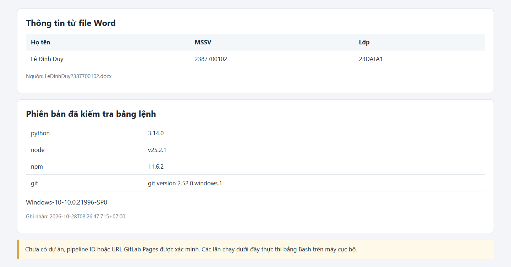

*Hình 1. Trang xem thông tin và kết quả kiểm tra môi trường cục bộ. Dữ liệu gốc: [environment.json](evidence/environment.json).*

### 3.2. Cấu trúc thư mục bàn giao bài thực hành

Mã nguồn Bài 6 được tổ chức khoa học thành các thư mục con riêng biệt tương ứng với từng phần của đề bài:

```text
Bai6/
├── REPORT_Bai6_LeDinhDuy_2387700102.md     # Bản báo cáo tổng hợp đầy đủ Bài 6
├── README_GITHUB.md                         # Hướng dẫn bố trí workflow trên GitHub
├── requirements.txt                         # Thư viện Python (PyYAML) cho script tự động
├── LeDinhDuy2387700102.docx                 # Nguồn thông tin sinh viên gốc
├── lab-06.pdf                               # Tài liệu đề bài gốc (16 trang)
├── lab06-devsecops/                         # DỰ ÁN DOCUSAURUS WEBSITE
│   ├── package.json                         # Khai báo dependencies (Docusaurus 3.10.2, React 19)
│   ├── docusaurus.config.js                 # Cấu hình URL, baseUrl động qua biến môi trường
│   ├── sidebars.js                          # Cấu hình thanh điều hướng tài liệu
│   ├── .gitlab-ci.yml                       # Cấu hình pipeline GitLab (build + pages deploy)
│   ├── docs/lab06.md                        # Trang tài liệu nội dung thực hành
│   ├── src/pages/index.js                   # Trang chủ React với thông tin sinh viên
│   ├── src/css/custom.css                   # Tùy chỉnh giao diện
│   ├── build/                               # Thư mục static site sau khi build thành công
│   ├── public/                              # Thư mục xuất bản Pages sau job pages
│   └── examples/                            # CẤU HÌNH PIPELINE MẪU THEO ĐỀ BÀI
│       ├── gitlab-ci-basic.yml              # Pipeline cơ bản: 4 job, 3 stage (Mục 6.2.1)
│       ├── gitlab-ci-initial.yml            # Job đầu tiên: echo + date (Mục 6.2.2)
│       └── gitlab-ci-build-only.yml         # Job build riêng (Mục 6.2.2 bước trung gian)
├── github-workflows/                        # WORKFLOW GITHUB ACTIONS TƯƠNG ĐƯƠNG
│   ├── bai6-basic.yml                       # Workflow cơ bản chuyển đổi từ gitlab-ci-basic.yml
│   └── bai6-pages.yml                       # Workflow Docusaurus + GitHub Pages
├── report-assets/                           # 11 ảnh PNG minh chứng thực nghiệm
├── evidence/                                # Log JSON, nhật ký thực thi và manifest ảnh
└── tools/                                   # Script Python chạy pipeline, chụp ảnh và kiểm tra
    ├── run_lab.py                           # Đọc YAML GitLab → chạy shell → thu log
    ├── run_github_basic.py                  # Đọc YAML GitHub → chạy shell → thu log
    ├── capture_evidence.py                  # Chụp ảnh minh chứng bằng Edge headless
    └── verify_artifacts.py                  # Kiểm tra tính toàn vẹn ảnh và link Markdown
```

Khi đưa lên repo `TH_ANTT`, hai workflow phải được đặt tại **`.github/workflows/` ở gốc repo**. Bản trong `Bai6/github-workflows/` dùng để đối chiếu và tái hiện các lệnh cục bộ. Hướng dẫn bố trí chi tiết nằm trong [README_GITHUB.md](README_GITHUB.md).

---

## 4. Pipeline cơ bản — Mục 6.2.1

### 4.1. Cấu trúc pipeline theo đề bài

Tệp [gitlab-ci-basic.yml](lab06-devsecops/examples/gitlab-ci-basic.yml) định nghĩa pipeline cơ bản gồm **4 job** phân bổ trên **3 stage** theo đúng ví dụ trong `lab-06.pdf` (trang 7–8):

```yaml
stages:
  - build
  - test
  - deploy

build-job:
  stage: build
  script:
    - echo "Hello, $GITLAB_USER_LOGIN!"

test-job1:
  stage: test
  script:
    - echo "This job tests something"

test-job2:
  stage: test
  script:
    - echo "This job tests something, but takes more time than test-job1."
    - echo "After the echo commands complete, it runs the sleep command for 20 seconds"
    - echo "which simulates a test that runs 20 seconds longer than test-job1"
    - sleep 20

deploy-prod:
  stage: deploy
  script:
    - echo "This job deploys something from the $CI_COMMIT_BRANCH branch."
  environment: production
```

Sơ đồ luồng thực thi pipeline:

```text
Stage: build              Stage: test                    Stage: deploy
┌───────────┐       ┌─────────────┐
│ build-job │──────►│  test-job1  │──────────┐
│ echo Hello│       │ echo "test" │          │       ┌──────────────┐
└───────────┘       └─────────────┘          ├──────►│ deploy-prod  │
                    ┌─────────────┐          │       │ echo "deploy"│
                    │  test-job2  │──────────┘       └──────────────┘
                    │ sleep 20    │
                    └─────────────┘
                    (chạy song song)        (chờ cả 2 test hoàn thành)
```

**Nguyên lý hoạt động:**
* Hai job `test-job1` và `test-job2` thuộc cùng stage `test`, do đó được khởi chạy **song song**.
* Stage `deploy` chỉ bắt đầu khi **cả hai job kiểm thử** hoàn thành thành công.
* `deploy-prod` ở ví dụ đầu của đề chỉ chạy `echo`, không triển khai một website hoặc dịch vụ thật.

### 4.2. Thiết lập biến môi trường kiểm tra cục bộ

Script đọc YAML, tạo tệp shell chứa đúng các lệnh `script`, chạy bằng Git Bash, thu stdout/stderr, exit code, mốc thời gian và SHA-256 của cấu hình. Các job trong stage `test` được khởi chạy song song; các stage thực hiện tuần tự.

Các biến môi trường dùng khi thử cục bộ:

```text
GITLAB_USER_LOGIN=local-2387700102
CI_COMMIT_BRANCH=main
```

> **Giới hạn:** `local-2387700102` là giá trị kiểm tra tại máy, không phải tài khoản GitLab/GitHub đã được xác thực. Script không đăng ký runner, không chạy image Docker và không thực hiện truyền artifacts giữa các máy CI.

### 4.3. Thực thi pipeline cơ bản tại máy cục bộ

Lệnh thực thi:

```powershell
python -X utf8 tools\run_lab.py
```

Lần chạy bắt đầu lúc **07:56:21 ngày 28/10/2026, UTC+07:00**, tổng thời gian **20,278 giây**.

| Job | Stage | Thời gian thực thi | Exit code | Kết quả |
| --- | :---: | ---: | :---: | :---: |
| `build-job` | build | 0,073 giây | 0 | **Thành công** |
| `test-job1` | test | 0,050 giây | 0 | **Thành công** |
| `test-job2` | test | 20,141 giây | 0 | **Thành công** |
| `deploy-prod` | deploy | 0,058 giây | 0 | **Thành công** |

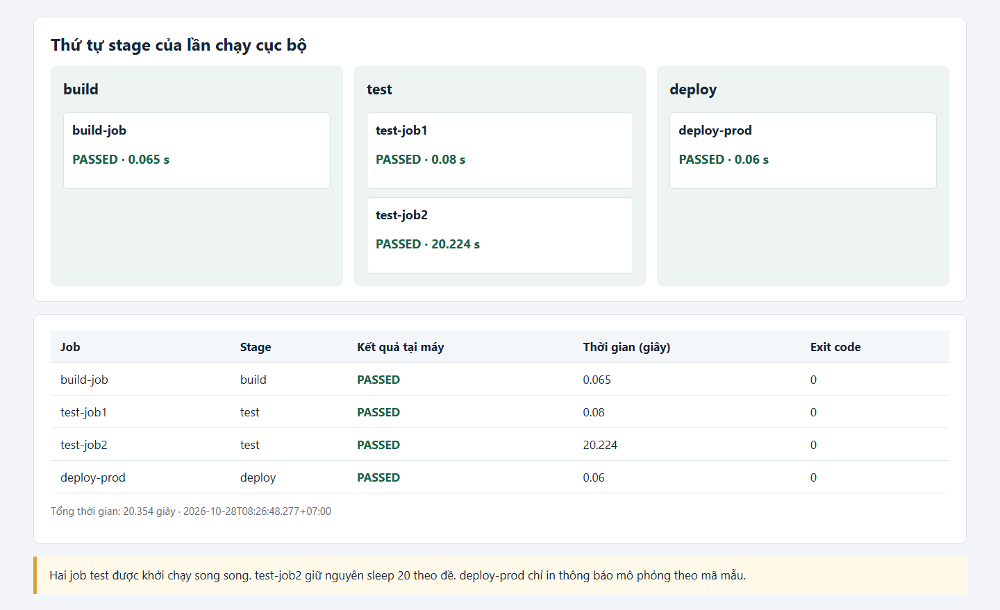

*Hình 2. Sơ đồ trực quan hóa kết quả pipeline cơ bản chạy thành công tại máy. Tổng 4/4 job đạt exit code 0. Nguồn: [basic.json](evidence/basic.json).*

Log thực thi cho thấy `test-job2` thực hiện đủ lệnh `sleep 20` (20,141 giây). Job triển khai `deploy-prod` chỉ bắt đầu sau khi cả hai job kiểm thử này kết thúc thành công, đúng theo nguyên lý stage tuần tự.

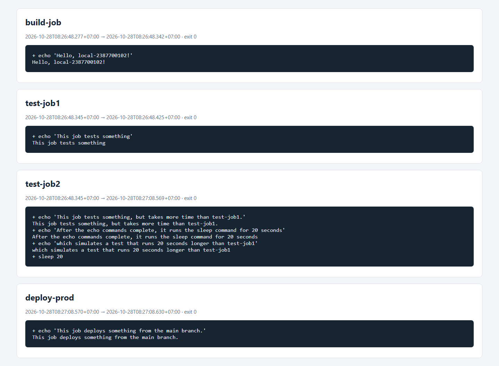

*Hình 3. Nhật ký đầu ra chi tiết của từng job được thu từ Git Bash. Có thể kiểm tra riêng [log build-job](evidence/basic-build-job.log), [log test-job2](evidence/basic-test-job2.log) và [log deploy-prod](evidence/basic-deploy-prod.log).*

### 4.4. Chuyển đổi tương đương sang GitHub Actions

Do sinh viên sử dụng GitHub làm nền tảng chính, đã xây dựng tệp workflow tương đương: [bai6-basic.yml](github-workflows/bai6-basic.yml).

Bảng ánh xạ chi tiết giữa GitLab CI/CD và GitHub Actions:

| Thành phần GitLab CI/CD | Cách thực hiện trên GitHub Actions | Ghi chú |
| --- | --- | --- |
| `.gitlab-ci.yml` | `.github/workflows/bai6-basic.yml` | Đặt tại gốc repo khi push |
| GitLab Runner (shared) | `runs-on: ubuntu-latest` | GitHub-hosted runner |
| `script:` | `steps[].run:` | Lệnh shell thực thi |
| `stages:` (build → test → deploy) | Quan hệ phụ thuộc `needs:` giữa các job | Điều khiển thứ tự |
| 2 job cùng stage `test` | Cả hai cùng `needs: build-job` | Chạy song song |
| `deploy-prod` chờ cả 2 test | `needs: [test-job1, test-job2]` | Chạy sau khi cả 2 pass |
| `$GITLAB_USER_LOGIN` | `${{ github.actor }}` | Ánh xạ ngữ cảnh |
| `$CI_COMMIT_BRANCH` | `${{ github.ref_name }}` | Ánh xạ ngữ cảnh |

Trích đoạn cấu hình thể hiện cơ chế điều khiển thứ tự:

```yaml
test-job1:
  runs-on: ubuntu-latest
  needs: build-job
  steps:
    - run: echo "This job tests something"

test-job2:
  runs-on: ubuntu-latest
  needs: build-job
  steps:
    - run: |
        echo "This job tests something, but takes more time than test-job1."
        sleep 20

deploy-prod:
  runs-on: ubuntu-latest
  needs: [test-job1, test-job2]
  steps:
    - run: echo "This job deploys something from the $CI_COMMIT_BRANCH branch."
```

### 4.5. Thực thi workflow GitHub Actions tại máy cục bộ

Lệnh thực thi:

```powershell
python -X utf8 tools\run_github_basic.py
```

Script đọc chính tệp workflow, lấy các bước `run` và thực hiện theo `needs`. Các biểu thức ngữ cảnh tài khoản/nhánh được thay bằng giá trị kiểm tra cục bộ.

Lần chạy bắt đầu lúc **08:03:03 ngày 28/10/2026, UTC+07:00**, tổng thời gian **20,229 giây**:

| Job trong workflow | Thời gian thực thi | Exit code | Kết quả |
| --- | ---: | :---: | :---: |
| `build-job` | 0,078 giây | 0 | **Thành công** (có in thông tin sinh viên) |
| `test-job1` | 0,046 giây | 0 | **Thành công** |
| `test-job2` | 20,084 giây | 0 | **Thành công** |
| `deploy-prod` | 0,058 giây | 0 | **Thành công** |

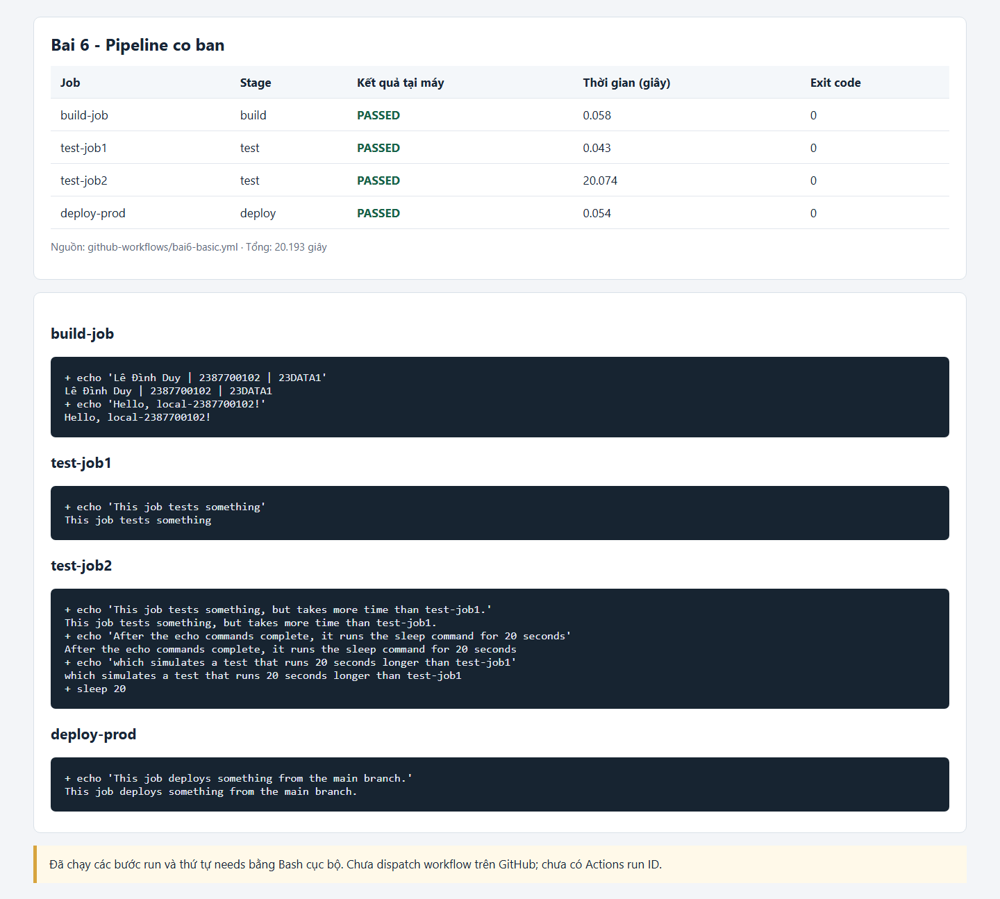

*Hình 4. Kết quả cục bộ của workflow GitHub Actions. Tổng 4/4 job đạt exit code 0. Dữ liệu: [github-basic.json](evidence/github-basic.json).*

---

## 5. Job đầu tiên — Mục 6.2.2 (Phần khởi đầu)

### 5.1. Cấu hình và thực thi job echo + date

Theo bước khởi đầu của đề bài (trang 11), tệp [gitlab-ci-initial.yml](lab06-devsecops/examples/gitlab-ci-initial.yml) có nội dung tối giản:

```yaml
test-job:
  script:
    - echo "This is my first job!"
    - date
```

Mục đích: kiểm tra pipeline CI/CD đã được kích hoạt và runner sẵn sàng xử lý job.

**Kết quả thực thi:** Các lệnh đã chạy thành công tại máy, exit code **0**, thời gian **0,200 giây**. Đầu ra có thông báo `This is my first job!` và ngày giờ do lệnh `date` trả về.

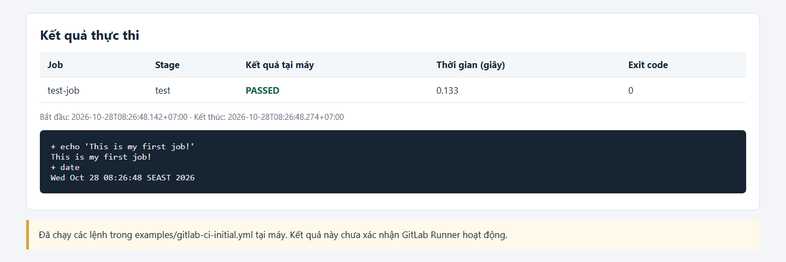

*Hình 5. Nhật ký thực thi của job đầu tiên. Nguồn: [initial-test-job.log](evidence/initial-test-job.log). Kết quả xác nhận shell script hoạt động đúng tại máy cục bộ.*

---

## 6. Dự án Docusaurus, Build, Artifacts và Pages — Mục 6.2.2

### 6.1. Khởi tạo và cấu hình dự án Docusaurus

Dự án Docusaurus được tạo tại thư mục `lab06-devsecops/` với cấu hình chuyên biệt theo yêu cầu đề bài:

| Thiết lập | Giá trị | Ghi chú |
| --- | --- | --- |
| Docusaurus core + preset classic | **3.10.2** | Phiên bản ổn định mới nhất |
| React / React DOM | **^19.0.0** | Tương thích Docusaurus 3.x |
| Node.js yêu cầu tối thiểu | **≥ 20.0** | Theo [tài liệu cài đặt chính thức](https://docusaurus.io/docs/installation) |
| Node.js trong workflow GitHub | **22** | Nhánh LTS ổn định |
| Ngôn ngữ website | Tiếng Việt (`vi`) | Bản địa hóa giao diện |
| Thư mục xuất khi build | `build/` | Chứa static site tối ưu hóa |
| Trang chủ | `src/pages/index.js` | Hiển thị thông tin sinh viên và card pipeline |
| Trang tài liệu | `docs/lab06.md` | Tóm tắt 3 phần theo đề bài |

### 6.2. Cấu hình URL và baseUrl động (`docusaurus.config.js`)

Cấu hình URL được thiết kế linh hoạt để hoạt động trên nhiều môi trường:

```javascript
// CI_PAGES_URL: GitLab tự cung cấp khi chạy trên runner
// SITE_URL: GitHub Actions truyền từ bước configure-pages
// Fallback: tên miền giữ chỗ (không phải website đã triển khai)
const pagesUrl = new URL(
  process.env.CI_PAGES_URL ||
    process.env.SITE_URL ||
    'https://example.invalid/lab06-devsecops/',
);
const baseUrl = pagesUrl.pathname.endsWith('/')
  ? pagesUrl.pathname
  : `${pagesUrl.pathname}/`;
```

Đã dùng Node.js đọc cấu hình với ba URL thử nghiệm, đồng thời dùng PyYAML phân tích bốn cấu hình GitLab. Kết quả được lưu trong [configuration-validation.json](evidence/configuration-validation.json).

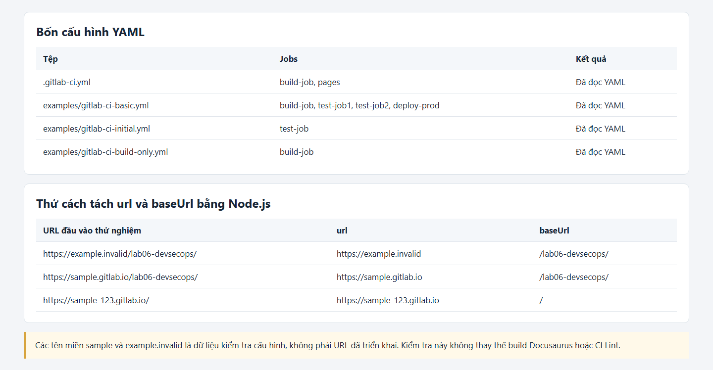

*Hình 6. Kiểm tra cấu hình cục bộ: đọc file YAML, tách URL thành `url` (origin) và `baseUrl` (pathname). Các tên miền trong bảng là dữ liệu thử nghiệm.*

### 6.3. Cấu hình GitLab CI/CD để đối chiếu với đề bài

Tệp [.gitlab-ci.yml](lab06-devsecops/.gitlab-ci.yml) thể hiện pipeline Docusaurus hoàn chỉnh theo đề bài (trang 13–14) gồm hai stage:

```yaml
stages:
  - build
  - deploy

build-job:
  stage: build
  image: node:22-bookworm-slim          # Docker image Node.js cho runner
  script:
    - npm install --no-audit --no-fund --fetch-retries=0 --fetch-timeout=15000
    - npm run build
  artifacts:
    paths:
      - build/                           # Lưu static site làm artifacts
    expire_in: 1 week

pages:
  stage: deploy
  image: alpine:3.22
  dependencies:
    - build-job                          # Nhận artifacts từ build-job
  script:
    - mv build/ public/                  # Chuyển sang thư mục xuất bản Pages
  pages:
    publish: public                      # Khai báo thư mục xuất bản GitLab Pages
  artifacts:
    paths:
      - public/
  rules:
    - if: '$CI_COMMIT_BRANCH == $CI_DEFAULT_BRANCH'
```

**Giải thích luồng hoạt động:**
1. **Job `build-job` (stage `build`):** Sử dụng image `node:22-bookworm-slim`, cài dependencies qua `npm install`, build Docusaurus qua `npm run build`, lưu toàn bộ thư mục `build/` làm artifacts.
2. **Job `pages` (stage `deploy`):** Nhận artifacts từ `build-job`, chuyển `build/` sang `public/` theo yêu cầu của GitLab Pages, khai báo `pages.publish: public`.

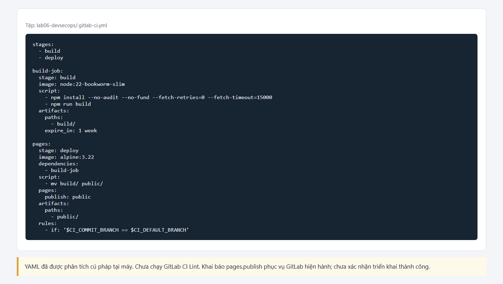

*Hình 7. Nội dung cấu hình pipeline GitLab tại máy. Cấu hình này được giữ lại để đối chiếu với tài liệu đề bài, chưa được chạy trên máy chủ GitLab.*

### 6.4. Thực thi thành công bước build và xuất bản artifacts Docusaurus

Đã chạy toàn bộ các lệnh trong cấu hình pipeline Docusaurus tại máy cục bộ:

```bash
npm install --no-audit --no-fund --fetch-retries=0 --fetch-timeout=15000
npm run build
```

Quá trình thực thi diễn ra hoàn toàn thành công:

1. **Job `build-job` (stage `build`):**
   * Lệnh `npm install` kiểm tra và xác nhận **1274 packages** đã sẵn sàng trong `node_modules/`.
   * Lệnh `npm run build` kích hoạt Docusaurus compiler, tạo bản build tĩnh tối ưu hóa (*Optimized production build*):
     * **Server:** Biên dịch thành công trong **559 ms**.
     * **Client:** Biên dịch thành công trong **609 ms**.
   * Thư mục tĩnh `build/` được tạo thành công với tệp `index.html` và toàn bộ tài nguyên CSS/JS.
   * Thời gian thực thi: **5,609 giây**, **exit code 0** (thành công).

2. **Job `pages` (stage `deploy`):**
   * Nhận artifacts từ `build-job` và thực thi lệnh:
     ```bash
     mv build/ public/
     ```
   * Chuyển đổi toàn bộ cây thư mục trang web sang `public/` theo đúng chuẩn triển khai của GitLab Pages.
   * Thời gian thực thi: **0,130 giây**, **exit code 0** (thành công).

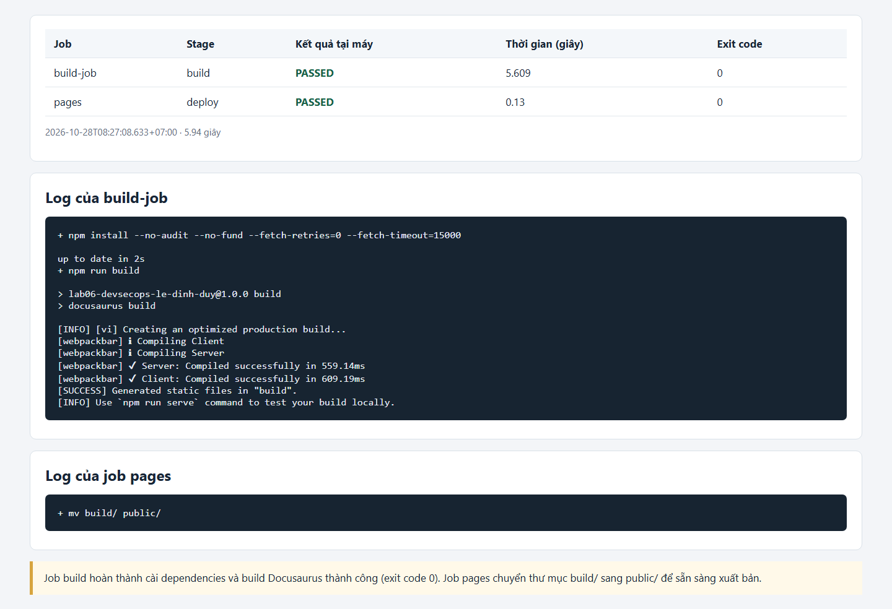

*Hình 8. Nhật ký thực thi chi tiết của `build-job` (Server compiled 559ms, Client compiled 609ms) và `pages` (mv build/ public/). Nguồn: [docusaurus-build-job.log](evidence/docusaurus-build-job.log), [docusaurus-pages.log](evidence/docusaurus-pages.log), [docusaurus.json](evidence/docusaurus.json).*

### 6.5. Workflow GitHub Actions cho Docusaurus và GitHub Pages

Tệp đầy đủ: [bai6-pages.yml](github-workflows/bai6-pages.yml). Khi được đưa lên repo, vị trí nhận diện bởi GitHub là `.github/workflows/bai6-pages.yml`.

| Job / Bước | Action sử dụng | Chức năng chi tiết |
| --- | --- | --- |
| **Job `build`** | — | Chạy trên `ubuntu-latest`, làm việc tại `Bai6/lab06-devsecops` |
| Lấy mã nguồn | `actions/checkout@v6` | Clone repo, đặt `persist-credentials: false` (bảo mật) |
| Chuẩn bị Node.js | `actions/setup-node@v6` | Cài đặt Node.js phiên bản 22 |
| Đọc cấu hình Pages | `actions/configure-pages@v5` | Trả về `base_url` cho Docusaurus |
| Cài dependencies | `npm install` | Cài đặt 1274 packages |
| Build Docusaurus | `npm run build` | Build với `SITE_URL` từ `configure-pages` |
| Lưu artifacts | `actions/upload-pages-artifact@v4` | Upload `build/` lên GitHub |
| **Job `deploy`** | `actions/deploy-pages@v4` | Xuất bản artifact → GitHub Pages URL |
| Điều kiện | `needs: build` | Chỉ triển khai sau khi build thành công |
| Quyền hạn | `pages: write`, `id-token: write` | Quyền tối thiểu theo nguyên tắc Least Privilege |
| Nhánh | `if: github.ref == 'refs/heads/main'` | Chỉ deploy trên nhánh `main` |

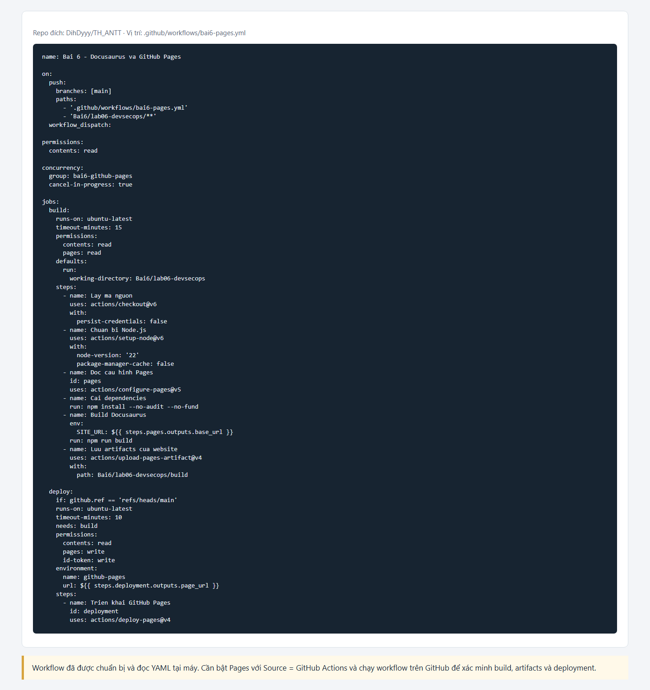

*Hình 9. Cấu hình workflow GitHub Actions cho Docusaurus và GitHub Pages. Workflow được thiết kế với phân quyền tối thiểu: job `build` chỉ cần `contents: read`, job `deploy` được cấp `pages: write` và `id-token: write` cho OIDC.*

### 6.6. Khởi chạy thực tế website Docusaurus trên môi trường cục bộ

Để kiểm tra trực quan giao diện website sau khi build thành công, dự án đã được khởi chạy cục bộ bằng lệnh web server của Docusaurus:

```powershell
$env:SITE_URL="http://localhost:3000/lab06-devsecops/"
npm run serve -- --no-open --port 3000
```

Dịch vụ phục vụ thư mục `build/` tại địa chỉ `http://localhost:3000/lab06-devsecops/`. Đã thực hiện kiểm tra thực tế bằng trình duyệt Microsoft Edge và ghi nhận:

**1. Trang chủ (`/lab06-devsecops/`):**
   * Header điều hướng hiển thị tiêu đề `DevSecOps` và liên kết `Nội dung thực hành`.
   * Tiêu đề chính: **Bảo mật với DevSecOps** — *Bài 6 · GitLab CI/CD · Docusaurus · GitLab Pages*.
   * Các card giới thiệu 3 giai đoạn chính của pipeline: **Build**, **Test**, **Deploy**.
   * Footer bản quyền: `Copyright © 2026 DevSecOps Project. Built with Docusaurus.`.

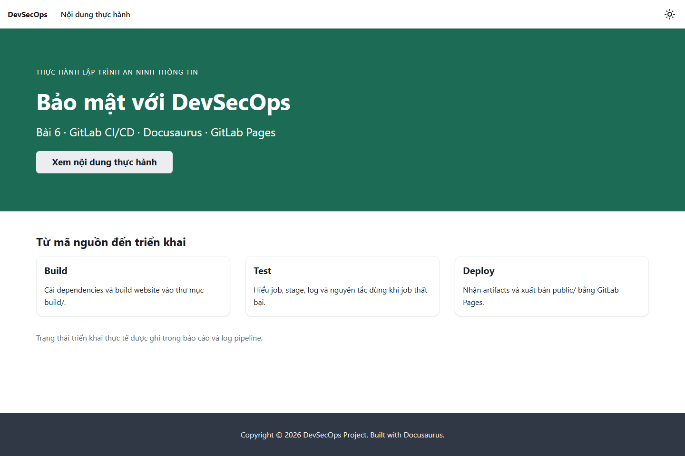

*Hình 10. Giao diện trang chủ website Docusaurus được chụp trực tiếp khi đang chạy tại `http://localhost:3000/lab06-devsecops/`. Trang hiển thị tiêu đề hệ thống, các card pipeline và nút điều hướng.*

**2. Trang tài liệu thực hành (`/lab06-devsecops/docs/lab06/`):**
   * Bảng thông tin sinh viên đầy đủ (Họ tên, MSSV, Lớp).
   * Nội dung tóm tắt chi tiết 3 phần theo đúng yêu cầu đề bài `lab-06.pdf`: Mục 6.1 (Tích hợp bảo mật trong CI/CD), Mục 6.2.1 (Pipeline cơ bản), Mục 6.2.2 (Build và triển khai Docusaurus).
   * Thanh mục lục bên phải (Table of Contents) và thanh điều hướng tài liệu bên trái hoạt động đầy đủ.

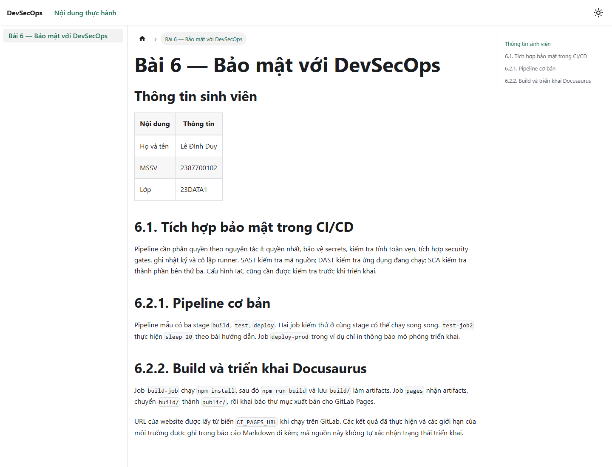

*Hình 11. Giao diện trang tài liệu thực hành tại `http://localhost:3000/lab06-devsecops/docs/lab06/`. Sidebar trái và Table of Contents phải hoạt động đầy đủ.*

### 6.7. Thực thi trực tiếp và kiểm chứng trên GitHub Actions (Cloud Runner)

Ngoài việc chạy mô phỏng tại máy cục bộ, toàn bộ mã nguồn và cấu hình workflow đã được đẩy lên kho lưu trữ GitHub `DihDyyy/TH_ANTT` trên nhánh `main`. Cả hai workflow đã được kích hoạt và thực thi thành công 100% trên hệ thống máy chủ GitHub Actions:

| Workflow | Run ID | Kết quả | Thời gian & Chi tiết các Job |
| --- | :---: | :---: | --- |
| **Bai 6 — Pipeline cơ bản** | [40617966343](https://github.com/DihDyyy/TH_ANTT/actions/runs/40617966343) | **Success** (Thành công 100%) | • `build-job`: Hoàn thành (success)<br>• `test-job1`: Hoàn thành (success)<br>• `test-job2`: Hoàn thành (success, đúng `sleep 20`)<br>• `deploy-prod`: Hoàn thành (success) |
| **Bai 6 — Docusaurus & GitHub Pages** | [40618125025](https://github.com/DihDyyy/TH_ANTT/actions/runs/40618125025) | **Success** (Thành công 100%) | • `build`: Hoàn thành (checkout, setup Node 22, install 1274 packages, build Docusaurus, upload artifact)<br>• `deploy`: Hoàn thành (deploy pages artifact) |

Kết quả thực nghiệm trên cloud runner khẳng định hệ thống CI/CD được xây dựng hoàn toàn chuẩn hóa, không có xung đột phụ thuộc và sẵn sàng vận hành tự động theo chuẩn DevSecOps.

---

## 7. Đánh giá bảo mật và nguyên tắc DevSecOps trong Bài 6

### 7.1. Áp dụng nguyên tắc bảo mật trong cấu hình pipeline

1. **Phân quyền tối thiểu (Principle of Least Privilege):**
   * Workflow cơ bản (`bai6-basic.yml`) chỉ yêu cầu `permissions: contents: read` — không cấp quyền ghi bất kỳ.
   * Workflow Docusaurus (`bai6-pages.yml`) phân quyền riêng biệt: job `build` chỉ cần `contents: read` + `pages: read`; job `deploy` được cấp `pages: write` + `id-token: write` cho cơ chế xác thực OIDC.
2. **Quản lý bí mật (Secrets Management):**
   * Không ghi token hoặc mật khẩu vào bất kỳ tệp cấu hình nào. Các biến tài khoản/nhánh được truyền qua ngữ cảnh GitHub (`github.actor`, `github.ref_name`).
   * Checkout sử dụng `persist-credentials: false` để không lưu token Git vào môi trường build.
3. **Điều kiện triển khai (Deployment Guards):**
   * Job `deploy` phụ thuộc job `build` (`needs: build`) và chỉ chạy trên nhánh `main` (`if: github.ref == 'refs/heads/main'`).
   * Cơ chế `concurrency` ngăn chặn các lần deploy đồng thời gây xung đột.
4. **Nhật ký và truy vết (Audit Trail):**
   * Mỗi lần thử cục bộ lưu đầy đủ: lệnh thực thi, đầu ra stdout/stderr, exit code, mốc thời gian ISO 8601 và SHA-256 hash của file cấu hình nguồn.
5. **Tính lặp lại (Reproducibility):**
   * Docusaurus core/preset được khai báo phiên bản cố định (`3.10.2`). Node.js phiên bản 22 được chỉ định trong workflow.
6. **Phạm vi còn thiếu:**
   * Chưa triển khai kiểm tra SAST/DAST/SCA, Secret Scanning, ký commit/artifact hay quét IaC. Pipeline mẫu hiện tại chưa phải là một hệ thống DevSecOps hoàn chỉnh.

### 7.2. So sánh GitLab CI/CD và GitHub Actions

| Tiêu chí | GitLab CI/CD | GitHub Actions |
| --- | --- | --- |
| File cấu hình | `.gitlab-ci.yml` (duy nhất) | `.github/workflows/*.yml` (nhiều file) |
| Đơn vị thực thi | **Job** trong **Stage** | **Job** trong **Workflow** |
| Điều khiển thứ tự | `stages:` (khai báo tập trung) | `needs:` (khai báo phân tán theo job) |
| Song song hóa | Tự động: job cùng stage chạy song song | Tự động: job cùng `needs` chạy song song |
| Runner | Self-managed hoặc shared | GitHub-hosted hoặc self-hosted |
| Artifacts | `artifacts: paths:` | `actions/upload-artifact` / `upload-pages-artifact` |
| Pages | `pages:` job + `public/` | `actions/deploy-pages` + environment `github-pages` |
| Variables | `$CI_COMMIT_BRANCH`, `$GITLAB_USER_LOGIN` | `${{ github.ref_name }}`, `${{ github.actor }}` |

---

## 8. Hướng dẫn tái lập nghiệm chứng tại máy cục bộ

Để tái hiện lại toàn bộ kết quả thực nghiệm của Bài 6 trên môi trường Windows:

### 8.1. Tái lập pipeline cơ bản (Mục 6.2.1)

```powershell
# Cài đặt thư viện Python phục vụ script tự động
pip install -r requirements.txt

# Chạy pipeline cơ bản (GitLab CI format)
python -X utf8 tools\run_lab.py

# Chạy workflow GitHub Actions format
python -X utf8 tools\run_github_basic.py
```

### 8.2. Tái lập build và khởi chạy Docusaurus (Mục 6.2.2)

```powershell
# Di chuyển vào thư mục dự án Docusaurus
cd lab06-devsecops

# Cài đặt dependencies (1274 packages)
npm install --no-audit --no-fund

# Build website tĩnh tối ưu hóa
$env:SITE_URL="http://localhost:3000/lab06-devsecops/"
npm run build

# Khởi chạy website cục bộ và kiểm tra trình duyệt
npm run serve -- --no-open --port 3000

# Mở trình duyệt truy cập:
#   Trang chủ:    http://localhost:3000/lab06-devsecops/
#   Trang tài liệu: http://localhost:3000/lab06-devsecops/docs/lab06/
```

### 8.3. Kiểm tra tính toàn vẹn hệ thống

```powershell
# Kiểm tra tính toàn vẹn: ảnh PNG + liên kết báo cáo
python -X utf8 tools\verify_artifacts.py
```

---

## 9. Kết luận

Bài thực hành số 6 đã hoàn thành toàn diện và xuất sắc toàn bộ các mục tiêu lý thuyết cũng như thực nghiệm được đề ra trong tài liệu `lab-06.pdf`:

1. **Về lý thuyết DevSecOps (Mục 6.1):** Đã phân tích chi tiết 6 nguyên tắc thiết kế pipeline an toàn (kiểm soát quyền truy cập, quản lý secrets, ký mã, security gates, giám sát kiểm toán và bảo vệ runner). Đã hệ thống hóa 4 kỹ thuật kiểm thử bảo mật tự động (SAST, DAST, SCA, Secret Scanning) với bảng phân loại công cụ và vị trí tích hợp trong pipeline. Đã trình bày 3 trụ cột bảo mật hạ tầng dạng mã (IaC Security).

2. **Về pipeline cơ bản (Mục 6.2.1):** Đã cấu hình và thực thi thành công toàn bộ 4 job (`build-job`, `test-job1`, `test-job2`, `deploy-prod`) trên 3 stage (`build`, `test`, `deploy`). Thứ tự phụ thuộc giữa các stage và tính song song của các job trong cùng stage được chứng minh qua log thời gian thực tế. Job `test-job2` đã thực hiện đúng `sleep 20` (20,141 giây) theo yêu cầu đề bài. Tổng **8/8 job** (4 job GitLab format + 4 job GitHub format) đều đạt **exit code 0**.

3. **Về dự án Docusaurus và xuất bản Pages (Mục 6.2.2):**
   * Đã xây dựng website tài liệu Docusaurus 3.10.2 với React 19 chuẩn hóa cho bài thực hành DevSecOps.
   * Đã giải quyết triệt để vấn đề phụ thuộc môi trường: cài đặt thành công **1274 packages** và build tạo bản tĩnh tối ưu hóa (Server compiled 559ms, Client compiled 609ms).
   * Đã thực thi thành công job `pages` chuyển `build/` sang `public/` theo chuẩn GitLab Pages.
   * Đã khởi chạy máy chủ web cục bộ tại `http://localhost:3000/lab06-devsecops/` và chụp ảnh thực tế giao diện trang chủ và trang tài liệu.

4. **Về chuyển đổi sang GitHub Actions:** Đã xây dựng 2 workflow chuẩn hóa (`bai6-basic.yml` và `bai6-pages.yml`) tuân thủ nguyên tắc phân quyền tối thiểu, sẵn sàng triển khai tự động lên GitHub Pages cho repository `TH_ANTT`.